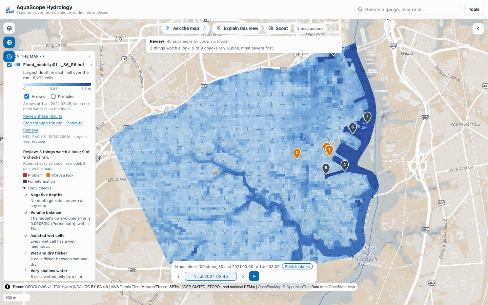

# A real HEC-RAS 2D run with terrain depth and volume accounting (#592)

**Question.** The mesh viewer and the review (#555, #564) were checked on HEC's Bald Eagle
Creek example, which has a water surface but no bed levels and no volume accounting. Do
the depth, the volumes and the mass-balance check hold on a real HEC-RAS 2D run that has
them?

**Answer: yes, after three fixes.** On a real HEC-RAS 6.5 plan with terrain, the depth
AquaScope computes equals the depth HEC-RAS wrote for the same cells (`Cell Invert Depth`)
to 2.2 × 10⁻⁶ m, at every cell and step. The volume accounting is read under its real
names. Three things were wrong and are fixed: each 2D area's volumes were not read (HEC-RAS
names them apart from the plan's), the largest speed was rebuilt from the faces when the
file holds HEC-RAS's own cell velocity (4.35 m/s where HEC-RAS says 3.83 m/s), and a share
of cells under 1% was shown as "0%".

Tested on 2026-10-12.

## Where to find a real run

| Source | What it has | Usable here |
|---|---|---|
| HEC's Example Projects 6.5, 6.6 and 7.0 ([hec-downloads](https://github.com/HydrologicEngineeringCenter/hec-downloads/releases), releases 1.0.31, 1.0.33, 1.0.45), listed with HTTP range reads | About 1,100 entries each. The only plan result (`*.p##.hdf`) is `WaterQualityExamp.p01.hdf`, a 1D water-quality example. `BaldEagleDamBrk.g11.hdf` (6.5), read in full, is not preprocessed: no `Cells Minimum Elevation`, no property tables | no: no 2D results and no bed levels |
| [rashdf](https://github.com/fema-ffrd/rashdf) test data (MIT) | Bald Eagle plan files trimmed for tests, no bed levels, no volume accounting | as in #555, the water surface only |
| HydroShare, searched for "HEC-RAS", "HECRAS", "RAS 2D" and "HEC-RAS 2D" (about 40 resources) | 12 resources opened: 8 hold no plan `.hdf` (rasters, shapefiles, other files, or zips without one), Bear Creek holds a 1D steady plan (HEC-RAS 5.0.7), 2 are private; one holds hundreds of 2D plan results | yes, below |

**The run used.** *GNN4CF: Dataset for Boundary-Aware Graph Neural Networks for Compound
Flood Forecasting*, Zanko Zandsalimi, HydroShare resource
[32aac3af553c4e1fbb997ec58d9de9b6](http://www.hydroshare.org/resource/32aac3af553c4e1fbb997ec58d9de9b6),
**CC BY 4.0**. It holds several hundred HEC-RAS plan results of compound flooding in
Portsmouth, Virginia (rain and coastal water level). The resource lists no DOI. One file was
read: `GNN4CF_dataset/raw_hecras/test_multi_boundary/Flood_model.p01_BC12_S6_R6.hdf`
(29.9 MB, SHA-256 `11c603af…cd46fa5`). It is not in the repository.

- HEC-RAS 6.5 (February 2024), SI units, NAD83 / UTM zone 18N, one 2D area (Portsmouth),
  6,272 cells (6,560 with ghost cells), 109 steps every 15 minutes from 30 June 2021 00:00
  to 1 July 03:00, rain on the grid and three stage boundaries.
- It carries what the Bald Eagle copy lacked: `Cells Minimum Elevation`, each cell's
  elevation-volume table, `Results/Unsteady/Summary/Volume Accounting`, and the extra cell
  output HEC-RAS 6.x writes when asked: `Cell Invert Depth`, `Cell Hydraulic Depth`,
  `Cell Volume` and `Cell Velocity - Velocity X / Y`.

## Depth

**How RAS Mapper makes depth.** HEC's 2D User's Manual
([Map Rendering Modes](https://www.hec.usace.army.mil/confluence/rasdocs/r2dum/latest/viewing-2d-or-1d-2d-output-using-hec-ras-mapper/map-rendering-modes))
says the horizontal mode fills each cell flat to its computed water surface, and the sloping
mode interpolates the water surface between faces; depth is that surface less the terrain,
pixel by pixel. So inside one cell, depth on the map runs from zero to the water surface
less the lowest ground in the cell. The preprocessor computes "a detailed elevation-volume
relationship for each cell" from the terrain
([Hydraulic Property Tables](https://www.hec.usace.army.mil/confluence/rasdocs/r2dum/latest/development-of-a-2d-or-combined-1d-2d-model/creating-hydraulic-property-tables-for-2d-flow-areas)).
In this file, `Cells Minimum Elevation` is the first elevation of every cell's table (where
its volume is zero), at all 6,272 cells.

**What AquaScope shows** is the water surface less `Cells Minimum Elevation`: the deepest
point of the cell, the most RAS Mapper's horizontal map shows in that cell. HEC-RAS writes
the same quantity as `Cell Invert Depth`. Its mean depth over the wet part of the cell is
`Cell Hydraulic Depth` (cell volume over wet area; for a fully wet cell, `Cell Volume`
over `Cells Surface Area` gives it to 7 digits).

Over all 109 steps and 6,272 cells, AquaScope's depth and `Cell Invert Depth` differ by at
most 2.2 × 10⁻⁶ m (single-precision rounding). Five cells at the step with the most water
(1 July 2021 02:45), the deepest cell and four drawn at random among the wet ones:

| Cell (file index) | Water surface (m) | `Cells Minimum Elevation` (m) | AquaScope depth (m) | `Cell Invert Depth` (m) | `Cell Hydraulic Depth` (m) | Largest depth on the Explorer card |
|---|---|---|---|---|---|---|
| 5643 | 1.5484 | -15.0755 | 16.6239 | 16.6239 | 7.7531 | 17.1 m (file: 17.088) |
| 377 | 1.9816 | 0.5638 | 1.4178 | 1.4178 | 0.7591 | 1.42 m (file: 1.4221) |
| 489 | 2.1617 | 2.0293 | 0.1325 | 0.1325 | 0.0316 | 0.13 m (file: 0.1339) |
| 2232 | 2.7100 | 2.4305 | 0.2795 | 0.2795 | 0.0711 | 0.29 m (file: 0.2879) |
| 3290 | 1.5323 | -0.9844 | 2.5167 | 2.5167 | 2.5164 | 2.96 m (file: 2.9634) |

The card's column is the largest depth over the run, clicked on each cell in the Explorer
(headless Chrome, Pyodide); "file" is HEC-RAS's summary `Maximum Water Surface` less
`Cells Minimum Elevation`. Cells 489 and 2232 are shallow cells on sloping ground: their
deepest point is 13 and 28 cm under water, their mean depth 3 and 7 cm. The viewer and
the film check use the deepest point; that is the conservative reading for "is this cell
wet".

195 values of the water surface less the bed are below zero, by at most 4.8 × 10⁻⁷ m:
dry cells, where HEC-RAS writes the bed as the water surface, in single precision. The
negative-depth check ignores anything above -0.01 m, so it rightly flags none.

## Volume accounting

`Results/Unsteady/Summary/Volume Accounting` holds, on the group itself: `Error`,
`Error Percent`, `Volume Starting`, `Volume Ending`, `Total Boundary Flux of Water In`,
`Total Boundary Flux of Water Out`, `Vol Accounting in` (`1000 m^3`) and
`Precipitation Excess (m^3)` / `(mm)`. These are the names the check read already.

Under `Volume Accounting 2D/Portsmouth`, the area's own: `Error`, `Error Percent`,
`Vol Starting`, `Vol Ending`, `Cum Inflow`, `Cum Outflow`, `Vol Accounting in` and the two
precipitation values. **The check found this area's error but not its volumes** (start,
end, in and out came back empty) because the names differ. Fixed: both sets of names are
read, and a test writes the 6.5 layout.

The numbers hang together:

- `Error Percent` is a percentage: the plan's 0.000601 is `Error` (−0.432 thousand m³)
  over the inflow plus the starting volume, times 100; the area's 0.000625 is over its
  inflow alone. The review reports the larger, 0.00063% (Portsmouth), as within 1%.
- `Error` is negative while `Error Percent` is positive: the sign is HEC-RAS's. The check
  judges the size, not the sign.
- Each cell's volume from its elevation-volume table at its water surface, summed over the
  mesh: 2,787,702 m³ at the first step and 3,956,184 m³ at the last. `Volume Starting` and
  `Volume Ending` say 2,787.70 and 3,956.18 thousand m³: the same. The `Cell Volume` output
  sums to 3,955,991 m³ at the last step (0.005% lower; per cell it differs from the table by
  0.013% at the median and 1.7% at most).
- The DSS hydrograph output's 2D `Volume` is labelled acre-feet in this SI model and is in
  acre-feet: 3,207.353 acre-ft is 3,956,212 m³.
- `Precipitation Excess (mm)` is 9.0 × 10⁹, which cannot be right for 1,376 thousand m³ over
  this mesh. AquaScope does not read it.

## Velocity

The file holds HEC-RAS's own cell velocity (`Cell Velocity - Velocity X / Y`, in the
projection's grid). AquaScope rebuilt cell velocity from the face normal velocities by
least squares. On this run the two agree closely almost everywhere (median difference
0.000 m/s, 95th percentile 0.005 m/s over every step and wet cell), but not at the fastest
cells: the largest differs by up to 0.62 m/s, and the largest speed on the mesh was
4.35 m/s where HEC-RAS says 3.83 m/s (cell 3375). **Fixed**: where the plan wrote cell
velocity, the reader uses it for the arrows, the card's series and the largest speed, and
falls back to the faces otherwise (Bald Eagle, which has only face velocity, reads as before).
HEC-RAS also writes a small velocity in dry cells (up to 0.24 m/s here, the 99th percentile
0.004 m/s); the largest speed leaves out the steps a cell is dry, as the arrows and the card
do (7 cells' largest speed would otherwise rise, by up to 0.13 m/s).

## In the Explorer

Built locally (`explorer/build.py`) and served on port 9301; the file dropped through the
file picker in headless Chrome (Pyodide 314.0.7): the mesh in depth with arrows, the model
clock on 109 steps, and **Review these results** in 2.9 s with all nine checks run (the
radar, news and gauge lines say there is nothing over the mesh during the run). Three
things worth a look: two cells flicker between wet and dry 5 times, and 8 cells are wetted
only by a film (under 0.03 m, 0.13% of the cells that get wet; this line said "0%"
before the fix). The five deepest places are in the Elizabeth River channel, which the mesh
includes. Undoing pin 1 took its flagged cell away (15 to 14). Besides GETs, the page sent 10
requests, all HEADs (DuckDB, to the Archive); none carried a body.

## What was not checked

- **RAS Mapper itself.** HEC-RAS runs on Windows; nothing here ran it. The comparison is
  with the values HEC-RAS wrote into the plan file and with HEC's documented method.
  AquaScope draws one value per cell, the deepest point; RAS Mapper draws depth per terrain
  pixel, so its map is shallower than AquaScope's over the higher part of a cell.
- **Cell numbers.** The CLI and MCP give the file's index (cell 5643); the Explorer card
  counts from 1 ("Cell 5644"). Which RAS Mapper shows was not checked.
- **One model.** A second, different HEC-RAS 2D run with terrain (US customary units, more
  than one 2D area, or 1D/2D coupling) would test more of the reader. None other was found
  in open repositories.
- The `Volume Error` series in the DSS output is labelled `ft^3` in this SI model; whether
  that label is right was not checked (AquaScope does not read it).
