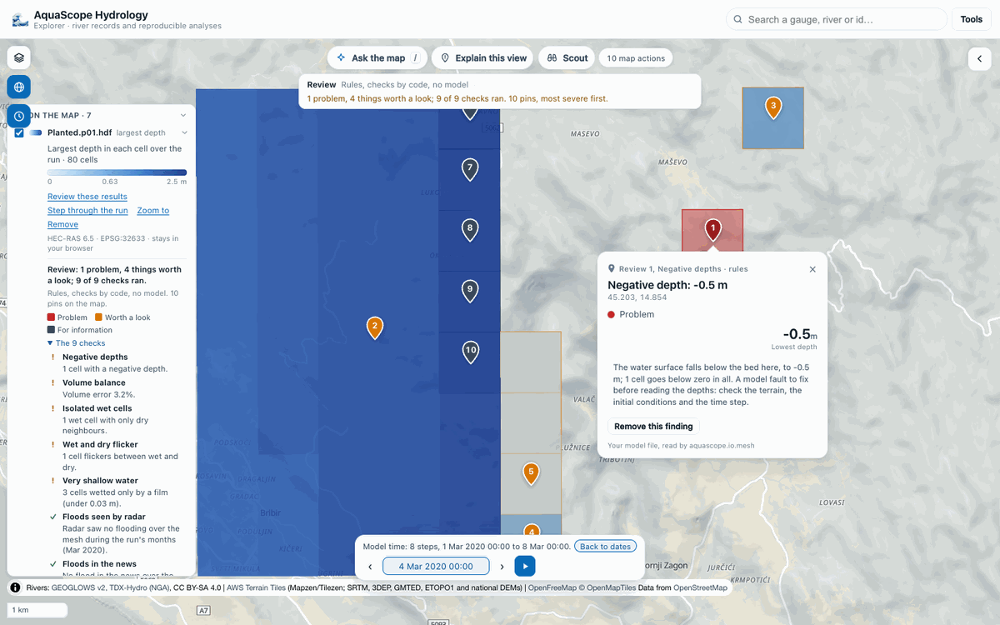
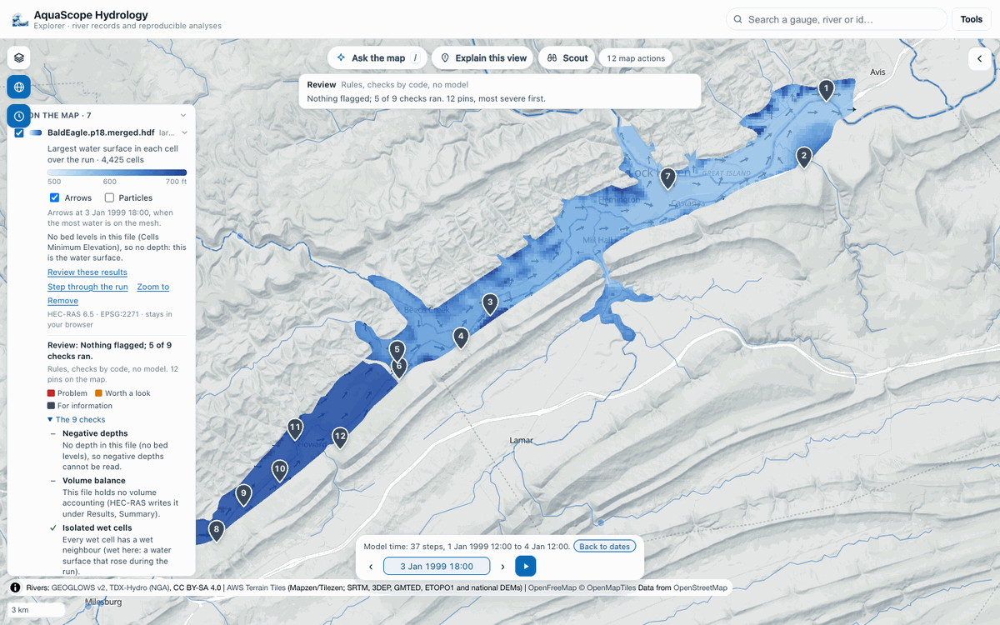

# Model results on a mesh: HEC-RAS 2D and UGRID

Modellers look at 2D results in RAS Mapper or in QGIS with Crayfish. AquaScope reads the
same files without a GIS: the cells of the mesh in longitude and latitude, the model's own
times, the depth (or the water surface), the velocity, and the largest depth and speed in
each cell over the run.

The same reader (`aquascope.io.mesh`) is behind every face:

- **Explorer**: drop the file on the map, or **Tools**, **Open model results**. The mesh is
  drawn on the globe, the time bar steps through the model's own times, and a click on a
  cell opens its card. The file stays in your browser ([explorer.md](explorer.md#your-model-results-on-the-globe-the-crayfish-view)).
- **CLI**: `aquascope mesh FILE [--crs EPSG] [--geometry G01_HDF] [--json]`.
- **MCP**: `mesh_summary(path, crs, geometry)`.
- **Python**: `read_ras_plan`, `read_ugrid` or `read_mesh`, and `mesh_summary`.
- **Review my model results** (#564): `aquascope mesh review FILE`, the MCP tool
  `mesh_review(path, crs, offline, geometry)`, and **Review these results** in the Explorer
  ([below](#review-my-model-results)).

```bash
aquascope mesh BaldEagleDamBrk.p18.hdf
aquascope mesh ADH_SanDiego.nc --crs 26911     # a file that does not say its coordinate system
aquascope mesh BaldEagleDamBrk.p18.timeseries.hdf --geometry BaldEagleDamBrk.g11.hdf   # a stripped plan
```

```python
from aquascope.io.mesh import read_mesh

m = read_mesh("my_run.p01.hdf")
m.n_cells, len(m.times), m.variable        # cells, time steps, "depth" (or "water_surface")
step = m.frame(10)                          # value, u (east), v (north) per cell, NaN where dry
cell = m.series(120)                        # the time series at one cell
m.close()
```

## What it reads

| | HEC-RAS 2D plan (`*.p01.hdf`) | UGRID 2D mesh (`*.nc`) |
|---|---|---|
| Library | h5py | h5py for NetCDF-4, scipy for NetCDF-3 classic |
| Cells | the 2D flow areas' cells, ghost cells left out; outlines from `Cells FacePoint Indexes`, or the cell's face points in order around its centre | the faces of the mesh topology (`cf_role = mesh_topology`), from `face_node_connectivity` |
| Coordinate system | RAS Mapper's projection, stored with the results | the coordinates in degrees, or the grid mapping's WKT or EPSG code |
| Times | `Time Date Stamp`, as RAS writes it | the `time` variable's CF units (`hours since 2021-02-03`) |
| Depth | water surface less `Cells Minimum Elevation`: the cell's deepest point, as HEC-RAS's `Cell Invert Depth` | a depth variable, or the water level less the bed level |
| Velocity | HEC-RAS's own cell velocity (`Cell Velocity - Velocity X / Y`) where the plan wrote it, else rebuilt per cell from the face normal velocities by least squares, weighted by face length; then turned to east and north | `ucx`/`ucy` (or the CF standard names), turned to east and north on a projected grid |
| Largest | RAS's summary output where present, else every time step | every time step |

Values on mesh nodes are averaged onto the faces. Layered (3D) variables are left out.

Without bed levels there is no depth, and the reader says so: the map shows the water
surface instead. Without a coordinate system it stops and asks for one (`crs=`, an EPSG
code or WKT). Times are given as the file gives them, with no time zone assumed.

**A stripped plan file** (`*.p01.timeseries.hdf`, or a plan saved without its geometry)
holds the results but not the mesh they sit on. The reader stops with one sentence that
names the missing part (for example `Geometry/2D Flow Areas/BaldEagleCr is missing`) and
says what to do: open the full plan file, or give the geometry file the plan was run with
(`geometry=`, `--geometry`, or both files dropped together in the Explorer). The mesh then
comes from the geometry file and everything else from the plan; a geometry file whose 2D
areas the plan has no results for, or with more cells than the results hold, is refused.
Such a file keeps no summary output, so the largest is over the saved time steps, and the
reader says so.

## Limits

- **2 GB per file.** Reads are lazy: the geometry and the maxima once, then one time step
  or one cell when asked. In the browser the file is mounted read-only in a worker
  (WORKERFS), not copied into memory.
- **250,000 cells.** What costs memory is the mesh itself: its outlines and two arrays per
  time step. A synthetic mesh of 249,218 triangles opens in the Explorer in about five
  seconds from the drop, Python's start included.

## Review my model results

A modeller's first question about a run is "does it look right?". `aquascope.mesh_review`
answers with checks made by code, each a finding with its place (lat/lon), severity
(problem, worth a look, for information), value, unit, reason and source, and one line
per check saying what it found or why it could not run.

| Check | What it flags | Severity |
|---|---|---|
| Deepest water | the deepest place in up to five parts of the mesh, with the depth and the model time it was reached. Without bed levels, the largest rise of the water surface, said so | information |
| Negative depths | a water surface under the bed at any step | problem |
| Very shallow water | cells never deeper than 3 cm (about 0.1 ft): a film, from rain on the grid, the terrain or a tolerance | worth a look |
| Isolated wet cells | a cell wet while every neighbour stays dry | worth a look |
| Wet and dry flicker | a cell that changes between wet and dry 4 times or more (needs 5 steps or more) | worth a look |
| Volume balance | the volume error HEC-RAS wrote itself (`Results/Unsteady/Summary/Volume Accounting`, the plan's and each 2D area's under `Volume Accounting 2D`): over 1% worth a look, over 5% a problem | as said |
| Floods seen by radar | 0.05° squares where Sentinel-1 saw flooding (Microsoft AI for Good, Oct 2014 to Sep 2024) and the model keeps every cell dry | worth a look in the run's months, information otherwise |
| Floods in the news | Groundsource flood reports (2000 on) whose footprint covers cells the model keeps dry | worth a look in the run's days, information otherwise |
| Gauges in the mesh | the observed peak at each Archive gauge standing in a cell (the first five; the line counts them all) against the model's peak at that cell, timing only (a gauge measures flow or stage, the model depth); more than a day apart is worth a look. When no gauge stands inside the mesh, the line says so | as said |

When the run's months are outside the radar or news record, the comparison is made with
every month on record and every finding says "Not this event": it tells where floods
have been seen, not whether this event was modelled right. A check says it was skipped
when the file cannot answer it (no bed levels, no time steps, no volume accounting).

The checks are code. With the on-device model, or a key in Ask, a model only orders the
findings and words them, writing each number as a placeholder (`{f3}`) that code fills
in; Explain's claim lock (`aquascope.map_explain.claim_lock`) refuses wording with any
other number or with a sign or a digit set against a placeholder ("-{f3}", "{f3}0",
`placeholder_touches`, the check Explain and Scout make too), and a ranking word the rules
wording does not use is refused too. Without a
model, the package's templates say it.

```bash
aquascope mesh review my_run.p01.hdf             # with observed floods and gauges
aquascope mesh review my_run.p01.hdf --offline   # only the checks on the file
aquascope mesh review my_run.p01.hdf --json
```

```python
from aquascope.io.mesh import read_mesh
from aquascope import mesh_review

m = read_mesh("my_run.p01.hdf")
res = mesh_review.review(m, context=mesh_review.gather_context(m))
res["summary"]                     # "1 problem, 4 things worth a look; 9 of 9 checks ran."
[(f["severity"], f["title"]) for f in res["findings"]]
m.close()
```

In the Explorer, **Review these results** on the model's legend row (or "review my model"
in Ask the map) drops the findings as numbered pins coloured by severity, flags the cells
each one is about, and lists the checks under the legend row. Every pin is in the action
log: undo one and its flags go with it. The file stays in the browser; the radar and news
floods come from the Archive's context mirror and the gauge records from the Archive (or
the agency).



On HEC's Bald Eagle Creek example (the rashdf copy, which has no bed levels and runs in
January 1999) five checks run: the run is before the radar and news records, so the
floods are compared with every month on record; six Archive gauges stand in the mesh and
the first five are checked, two of them with daily records for those days (both falling from the start of the run, so
no peak to time) and three without; the largest rises of the water surface are pinned.



## Checked against real files (2026-10-11)

In Pyodide 314.0.7, the Explorer's Python, in Chrome:

- **HEC-RAS**: `BaldEagleDamBrk.p18.hdf` and `.p18.timeseries.hdf` from the
  [rashdf](https://github.com/fema-ffrd/rashdf) test data (MIT; a USACE HEC example
  project), joined with the plan's geometry `BaldEagleDamBrk.g11.hdf` from HEC's
  Example Projects 6.5. 4,425 cells in two 2D areas, 37 steps from 1 January 1999 12:00
  to 4 January 12:00. `read_mesh(timeseries, geometry=g11)` now does
  the join itself (0.14 s): the same cells, steps and speeds as the joined copy, and a
  largest water surface up to 0.15 ft lower, being over the 37 saved steps (the stripped
  file keeps no summary output). Read with h5py in 0.08 s. rashdf 0.12.0 also installs and reads it
  in the browser (7 s with its install), but brings geopandas and pyarrow (the worker's
  memory goes from 90 to 224 MB), so the reader uses h5py directly. The rashdf copy has
  no bed levels, so it shows the water surface.
- **UGRID**: `ADH_SanDiego.nc` from the [xugrid](https://github.com/Deltares/xugrid) sample
  data (MIT). 16,869 triangles, 49 steps. It states no coordinate system; EPSG 26911
  (UTM zone 11N) puts it on San Diego Bay. netCDF4 1.7.4 in Pyodide 314.0.7 cannot open
  NetCDF-4 files ("NetCDF: HDF error", even for a file it has just written), so the reader
  uses h5py, which reads them.
- **A large file**: the Bald Eagle results repeated to 1,110 steps (66 MB; real geometry,
  synthetic length). Mounting it costs no memory; one time step reads in 7 ms, a cell's
  1,110 values in 0.2 s, and the largest over all steps in 0.2 s.

- **A run with terrain and volume accounting** (#592): a HEC-RAS 6.5 plan of compound
  flooding in Portsmouth, Virginia, from HydroShare (CC BY 4.0). The depth equals the
  `Cell Invert Depth` HEC-RAS wrote, at every cell and step; the per-area volume names and
  HEC-RAS's own cell velocity are now read. Sources, licences and numbers:
  [assessments/hec-ras.md](assessments/hec-ras.md).

None of these files is in the repository; the tests make small synthetic ones.
