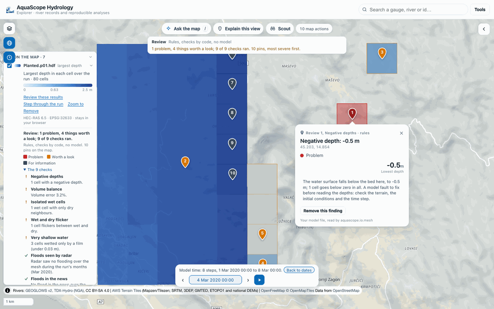
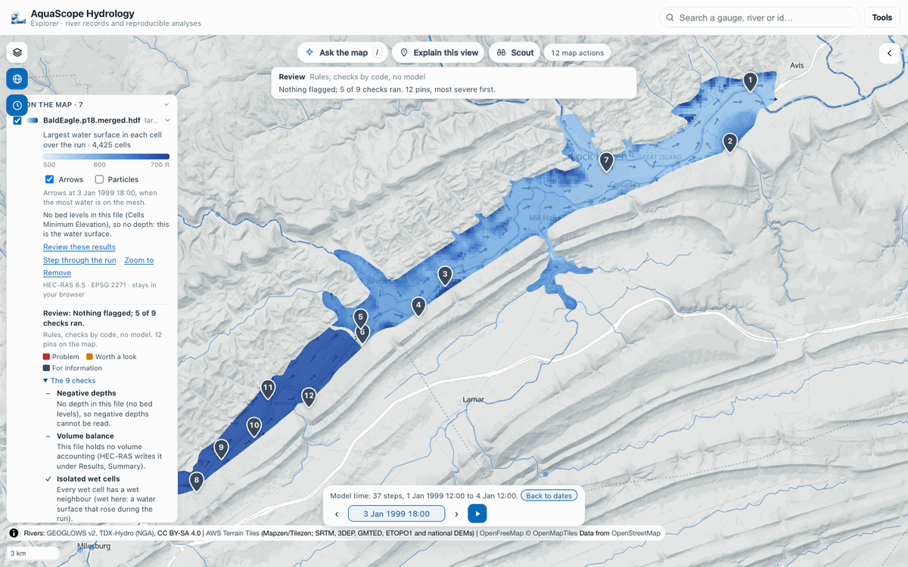
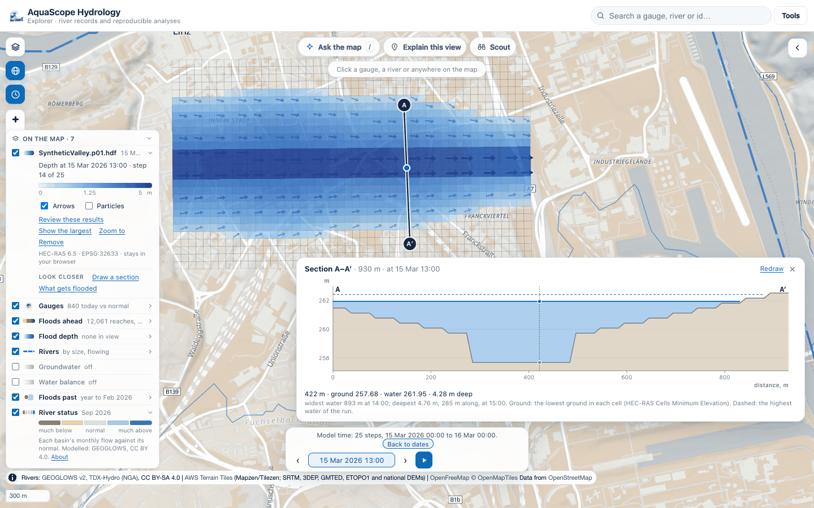
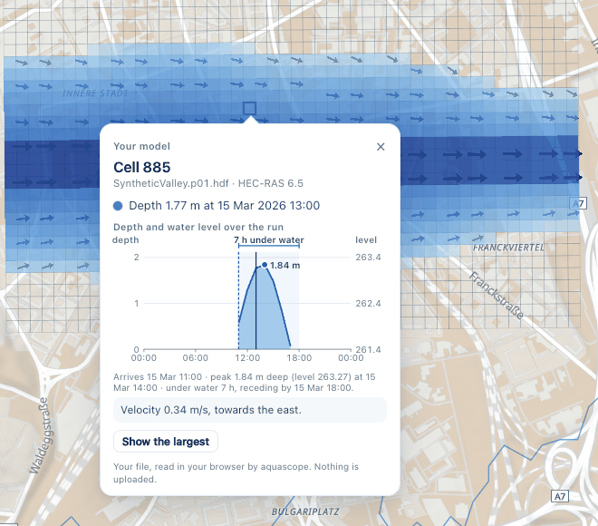
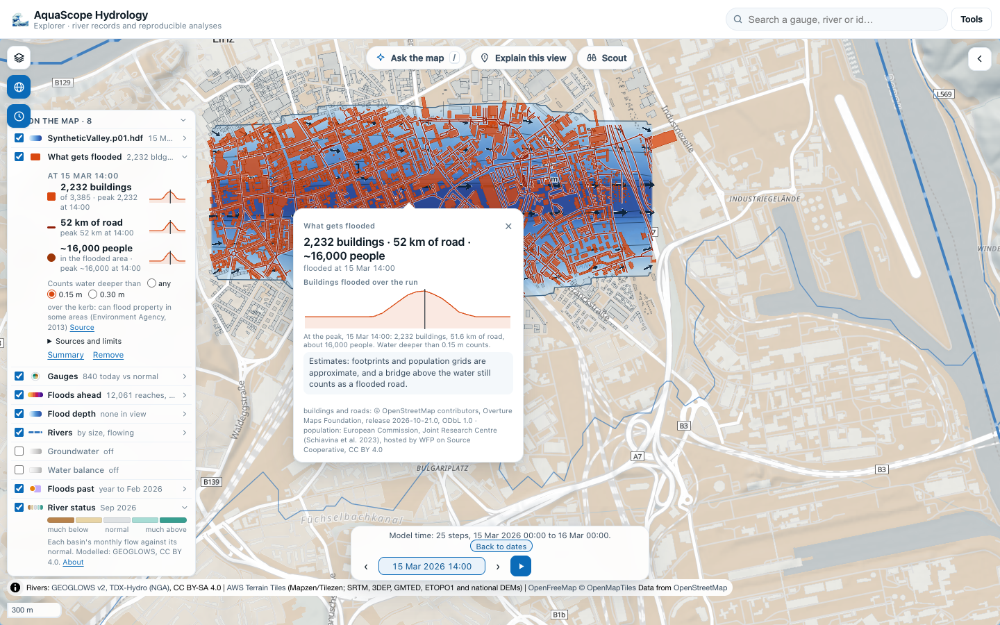

# Model results on a mesh: HEC-RAS 2D and UGRID

Modellers look at 2D results in RAS Mapper or in QGIS with Crayfish. AquaScope reads the
same files without a GIS: the cells of the mesh in longitude and latitude, the model's own
times, the depth (or the water surface), the velocity, and the largest depth and speed in
each cell over the run.

The same reader (`aquascope.io.mesh`) is behind every face:

- **Explorer**: drop the file on the map, or **Tools**, **Open model results**, which also
  offers a sample HEC-RAS 2D run (a HydroShare result, CC BY 4.0, from the Archive's copy in
  `samples/hec-ras/`). The mesh is drawn on the globe, the time bar steps through the
  model's own times, and a click on a cell opens its card. The file stays in your browser ([explorer.md](explorer.md#your-model-results-on-the-globe-the-crayfish-view)).
- **CLI**: `aquascope mesh FILE [--crs EPSG] [--geometry G01_HDF] [--json]`.
- **MCP**: `mesh_summary(path, crs, geometry)`.
- **Python**: `read_ras_plan`, `read_ugrid` or `read_mesh`, and `mesh_summary`.
- **Review my model results** (#564): `aquascope mesh review FILE`, the MCP tool
  `mesh_review(path, crs, offline, geometry)`, and **Review these results** in the Explorer
  ([below](#review-my-model-results)).
- **Smooth depth, contours and flood lenses** (#619, #620): `aquascope mesh lenses FILE`, the
  MCP tool `mesh_lenses(path, crs, geometry)`, and the lens buttons on the model's legend row
  in the Explorer ([below](#smooth-depth-contours-and-the-flood-lenses)).

```bash
aquascope mesh BaldEagleDamBrk.p18.hdf
aquascope mesh ADH_SanDiego.nc --crs 26911     # a file that does not say its coordinate system
aquascope mesh BaldEagleDamBrk.p18.timeseries.hdf --geometry BaldEagleDamBrk.g11.hdf   # a stripped plan
```

```python
from aquascope.io.mesh import read_mesh

m = read_mesh("my_run.p01.hdf")
m.n_cells, len(m.times), m.variable        # cells, time steps, "depth" (or "water_surface")
step = m.frame(10)                          # value, u (east), v (north) per cell, NaN where dry
cell = m.series(120)                        # the time series at one cell
m.close()
```

## What it reads

| | HEC-RAS 2D plan (`*.p01.hdf`) | UGRID 2D mesh (`*.nc`) |
|---|---|---|
| Library | h5py | h5py for NetCDF-4, scipy for NetCDF-3 classic |
| Cells | the 2D flow areas' cells, ghost cells left out; outlines from `Cells FacePoint Indexes`, or the cell's face points in order around its centre | the faces of the mesh topology (`cf_role = mesh_topology`), from `face_node_connectivity` |
| Coordinate system | RAS Mapper's projection, stored with the results | the coordinates in degrees, or the grid mapping's WKT or EPSG code |
| Times | `Time Date Stamp`, as RAS writes it | the `time` variable's CF units (`hours since 2021-02-03`) |
| Depth | water surface less `Cells Minimum Elevation`: the cell's deepest point, as HEC-RAS's `Cell Invert Depth` | a depth variable, or the water level less the bed level |
| Velocity | HEC-RAS's own cell velocity (`Cell Velocity - Velocity X / Y`) where the plan wrote it, else rebuilt per cell from the face normal velocities by least squares, weighted by face length; then turned to east and north | `ucx`/`ucy` (or the CF standard names), turned to east and north on a projected grid |
| Largest | RAS's summary output where present, else every time step | every time step |

Values on mesh nodes are averaged onto the faces. Layered (3D) variables are left out.

Without bed levels there is no depth, and the reader says so: the map shows the water
surface instead. Without a coordinate system it stops and asks for one (`crs=`, an EPSG
code or WKT). Times are given as the file gives them, with no time zone assumed.

**A stripped plan file** (`*.p01.timeseries.hdf`, or a plan saved without its geometry)
holds the results but not the mesh they sit on. The reader stops with one sentence that
names the missing part (for example `Geometry/2D Flow Areas/BaldEagleCr is missing`) and
says what to do: open the full plan file, or give the geometry file the plan was run with
(`geometry=`, `--geometry`, or both files dropped together in the Explorer). The mesh then
comes from the geometry file and everything else from the plan; a geometry file whose 2D
areas the plan has no results for, or with more cells than the results hold, is refused.
Such a file keeps no summary output, so the largest is over the saved time steps, and the
reader says so.

## Limits

- **2 GB per file.** Reads are lazy: the geometry and the maxima once, then one time step
  or one cell when asked. In the browser the file is mounted read-only in a worker
  (WORKERFS), not copied into memory.
- **250,000 cells.** What costs memory is the mesh itself: its outlines and two arrays per
  time step. A synthetic mesh of 249,218 triangles opens in the Explorer in about five
  seconds from the drop, Python's start included.

## Smooth depth, contours and the flood lenses

`aquascope.mesh_views` (experimental) turns a result into what RAS Mapper and Crayfish show
an engineer. Every number is computed there; the Explorer, `aquascope mesh lenses FILE` and
the MCP tool `mesh_lenses` only show it.

- **Smooth depth.** The cell values on a regular Web Mercator grid of about five pixels per
  cell, interpolated linearly between cell centres on their Delaunay triangulation (scipy),
  then softened by about half a cell so the triangles' creases do not show. A dry cell
  counts as zero depth, so the edge of the water tapers between the last wet and the first
  dry centre and is drawn as a line at 1 cm. A result file has no sub-grid terrain, so this is
  an interpolation of the cell values, not RAS Mapper's terrain-based depth.
- **Depth contours.** Lines at a round interval (1, 2, 2.5 or 5 times a power of ten) chosen
  so the depths most of the mesh reaches, up to their 90th percentile, get about five lines,
  carried on to the deepest water but never more than ten. The levels stay the same at every
  step, so a line moves with the water as the run plays. Traced with contourpy.
- **Arrival time.** The first output step with at least 0.1 m of water, in hours after the
  run's first output step: AquaScope's choice, deeper than the 1 cm that reads as wet, so a
  film does not count, and stated wherever it is shown. Cells wet from the start arrive at
  0 h. Lines of equal arrival are drawn at a round interval (0.25 h up to a week), traced
  halfway to the next output time, because arrival only changes between output steps. A line
  that no place reaches since the line before (it would lie on that one) is left out.
- **Largest depth and largest speed** over the run, with the output step of each.

**Flood hazard, H1 to H6.** The combined flood hazard curves of the Australian Disaster
Resilience Guideline 7-3, *Technical flood risk management guideline: Flood hazard*
(Australian Institute for Disaster Resilience, 2014), Table 1 (what each class means) and
Table 2 (its limits, which the guideline says are modelled after Smith and Wasko 2012), with the
background to the curves in Smith, Davey and Cox (2014), *Flood hazard*, UNSW Water Research
Laboratory Technical Report 2014/07
([the guideline](https://knowledge.aidr.org.au/media/1891/guideline-7-3-technical-flood-risk-management.pdf),
CC BY-NC 4.0). A place is in the lowest class whose three limits it meets:

| Class | D × V (m²/s) | Depth D (m) | Speed V (m/s) | Table 1 |
|---|---|---|---|---|
| H1 | ≤ 0.3 | ≤ 0.3 | ≤ 2.0 | Generally safe for vehicles, people and buildings. |
| H2 | ≤ 0.6 | ≤ 0.5 | ≤ 2.0 | Unsafe for small vehicles. |
| H3 | ≤ 0.6 | ≤ 1.2 | ≤ 2.0 | Unsafe for vehicles, children and the elderly. |
| H4 | ≤ 1.0 | ≤ 2.0 | ≤ 2.0 | Unsafe for vehicles and people. |
| H5 | ≤ 4.0 | ≤ 4.0 | ≤ 4.0 | Unsafe for vehicles and people. All building types vulnerable to structural damage. Some less robust building types vulnerable to failure. |
| H6 | > 4.0 | | | Unsafe for vehicles and people. All building types considered vulnerable to failure. |

The guideline asks for hazard "at all stages of the flood hydrograph", so each cell is
classified at every output step and keeps its highest class. The card gives the step at
which that class was worst (the largest D × V within it), with the depth and speed then. A run of more than 40 million cell values is classified once
from the largest depth and the largest speed, which may not happen together, and a note
says it can overstate. Files in feet are converted to metres first. A file without
velocities has no hazard; one without bed levels has no hazard and no arrival time.

```bash
aquascope mesh lenses SyntheticValley.p01.hdf
aquascope mesh lenses Flood_model.p01_BC12_S6_R6.hdf --json
```

```python
from aquascope.io.mesh import read_mesh
from aquascope import mesh_views

m = read_mesh("my_run.p01.hdf")
lenses = mesh_views.mesh_lenses(m)          # hazard, arrival_h, max_depth, max_speed, ... per cell
grid = mesh_views.field_grid(m)              # once per mesh
depth = mesh_views.smooth_field(grid, m.frame(10)["value"])          # (rows, cols), NaN where dry
lines = mesh_views.contour_lines(grid, depth, mesh_views.depth_levels(m), unit="m")   # GeoJSON
```

## Review my model results

A modeller's first question about a run is "does it look right?". `aquascope.mesh_review`
answers with checks made by code, each a finding with its place (lat/lon), severity
(problem, worth a look, for information), value, unit, reason and source, and one line
per check saying what it found or why it could not run.

| Check | What it flags | Severity |
|---|---|---|
| Deepest water | the deepest place in up to five parts of the mesh, with the depth and the model time it was reached. Without bed levels, the largest rise of the water surface, said so | information |
| Negative depths | a water surface under the bed at any step | problem |
| Very shallow water | cells never deeper than 3 cm (about 0.1 ft): a film, from rain on the grid, the terrain or a tolerance | worth a look |
| Isolated wet cells | a cell wet while every neighbour stays dry | worth a look |
| Wet and dry flicker | a cell that changes between wet and dry 4 times or more (needs 5 steps or more) | worth a look |
| Volume balance | the volume error HEC-RAS wrote itself (`Results/Unsteady/Summary/Volume Accounting`, the plan's and each 2D area's under `Volume Accounting 2D`): over 1% worth a look, over 5% a problem | as said |
| Floods seen by radar | 0.05° squares where Sentinel-1 saw flooding (Microsoft AI for Good, Oct 2014 to Sep 2024) and the model keeps every cell dry | worth a look in the run's months, information otherwise |
| Floods in the news | Groundsource flood reports (2000 on) whose footprint covers cells the model keeps dry | worth a look in the run's days, information otherwise |
| Gauges in the mesh | the observed peak at each Archive gauge standing in a cell (the first five; the line counts them all) against the model's peak at that cell, timing only (a gauge measures flow or stage, the model depth); more than a day apart is worth a look. When no gauge stands inside the mesh, the line says so | as said |

When the run's months are outside the radar or news record, the comparison is made with
every month on record and every finding says "Not this event": it tells where floods
have been seen, not whether this event was modelled right. A check says it was skipped
when the file cannot answer it (no bed levels, no time steps, no volume accounting).

The checks are code, and so is every word of a pin. With the on-device model, or a key in
Ask, the model picks and the code writes (#590): the model decides which findings to pin,
in what order, and which of three fixed wordings of each to show (`review_variants`: `a` the
rules' title and reason, `b` the check's name over the same reason, `c` the rules' title over
the reason's first sentence). Its reply is a JSON object held to a schema whose values are
enums, the finding ids and the variant ids (`review_schema`, passed to Chrome as
`responseConstraint`). It cannot change a value, a count, a bound, a severity or a "not": "Two
cells", "the deepest water is 17.1 m" without "in this part of the mesh", or "check if this depth
is expected" cannot reach a pin. A problem is pinned even when the model leaves it out; the
other findings it leaves out are said in the line ("2 findings not pinned"), and the legend's
list of checks keeps every one. So is a finding the question names: "is the model stable?",
"are there any numerical instabilities in this run?" and "is there flicker?" pin the wet and dry
flicker findings too (#646), since they are what was asked about (`named_findings`, and the
words reach the prompt as well). The review's counts are always the rules' counts. A reply
outside the schema is refused whole (`aquascope.map_pick.pick`), the line says so in one short
sentence, and every finding is pinned in the rules' order and wording. The older wording checks
(`negation_flip`, Explain's `claim_lock`) stay as a second line of defence: the tests hold every
variant to them. Without a model, the package's templates say it.

```bash
aquascope mesh review my_run.p01.hdf             # with observed floods and gauges
aquascope mesh review my_run.p01.hdf --offline   # only the checks on the file
aquascope mesh review my_run.p01.hdf --json
```

```python
from aquascope.io.mesh import read_mesh
from aquascope import mesh_review

m = read_mesh("my_run.p01.hdf")
res = mesh_review.review(m, context=mesh_review.gather_context(m))
res["summary"]                     # "1 problem, 4 things worth a look; 9 of 9 checks ran."
[(f["severity"], f["title"]) for f in res["findings"]]
m.close()
```

In the Explorer, **Review these results** on the model's legend row (or "review my model"
in Ask the map) drops the findings as numbered pins coloured by severity, flags the cells
each one is about, and lists the checks under the legend row. The line under the bar names
the file reviewed. From Ask the map the review is of the model on screen: with a MODFLOW
model there (which it does not read) or the mesh out of view, the line says so instead of
reviewing a mesh out of sight; the legend row's button reviews its own mesh wherever the map is. Every pin is in the action
log: undo one and its flags go with it. The file stays in the browser; the radar and news
floods come from the Archive's context mirror and the gauge records from the Archive (or
the agency).



On HEC's Bald Eagle Creek example (the rashdf copy, which has no bed levels and runs in
January 1999) five checks run: the run is before the radar and news records, so the
floods are compared with every month on record; six Archive gauges stand in the mesh and
the first five are checked, two of them with daily records for those days (both falling from the start of the run, so
no peak to time) and three without; the largest rises of the water surface are pinned.



## A section and a hydrograph

`aquascope.flood_section` (#621, experimental) is RAS Mapper's profile line and time series plot:

- `section(mesh, [[lon, lat], [lon, lat], ...])` reads the ground and the water level along a line, at every
  model step, with the highest water of the run, the distance along the line, the cell under each point, and a
  few facts (the length, the share on the mesh, the widest water and the deepest point, each with its step).
  The ground is the cell's bed level: HEC-RAS's `Cells Minimum Elevation`, the lowest terrain point in the
  cell, not the terrain under the line; a UGRID file's bed level. A file without bed levels gives the water
  surface only and says so.
- `hydrograph(mesh, cell)` (or `lon=`, `lat=`) gives the depth and the water level at one cell over the run,
  with the arrival, the peak, the recession and the duration. They follow HEC-RAS Mapper's Arrival Time,
  Duration and Recession maps ([Creating Results Maps](https://www.hec.usace.army.mil/confluence/rasdocs/rmum/6.3/mapping-results/creating-results-maps)):
  arrival is when the depth first exceeds a threshold, recession when it falls back below it for the last
  time, and the duration runs from one to the other, a second peak included. The threshold defaults to the
  readers' dry depth (0.01 in the file's unit); times are to the model's output interval. A cell still wet at
  the end of the run says its duration is a lower bound.

In the Explorer, **Draw a section** on the model's legend row, then drag across the flood or tap the two ends,
with a mouse, a pen or a finger. A panel above the time bar draws A to A′, stepping with the time bar; hover or
touch it to read a point and see it on the map. A click on a cell puts its hydrograph in the card, and the
step on show moves along it.





## What gets flooded

`aquascope.flood_exposure` (#622, experimental) counts the buildings, the road length and the people under the
water at every step and at the peak, and says when each building and stretch of road was under water.

- **Buildings**: a footprint counts when the depth passes the threshold in a cell under its centre or a
  corner. Source: Overture Maps buildings (ODbL 1.0, © OpenStreetMap contributors, Overture Maps Foundation;
  Overture's buildings also carry Microsoft and Google footprints and Esri Community Maps, see
  [Overture's attribution](https://docs.overturemaps.org/attribution/#buildings)).
- **Roads**: each road segment for vehicles (Overture transportation, subtype `road`, ODbL 1.0; service roads
  and tracks included, footways, sidewalks, paths, steps, pedestrian streets, cycleways and bridleways left
  out, `PATH_CLASSES`) is cut where it crosses from one cell to the next (the crossing found by bisection), and
  a stretch counts when its cell is flooded. In the synthetic valley the paths left out are 123 of the 207 km of
  `road` segments on the mesh, mostly mapped sidewalks.
- **People**: GHS-POP R2023A, the 2025 epoch at 3 arc-seconds (European Commission JRC; Schiavina et al.
  2023, [doi:10.2905/2FF68A52-5B5B-4A22-8F40-C41DA8332CFE](https://doi.org/10.2905/2FF68A52-5B5B-4A22-8F40-C41DA8332CFE),
  CC BY 4.0), read from the Cloud-Optimized GeoTIFF tiles WFP publishes on
  [Source Cooperative](https://source.coop/wfp/jrc-ghsl-pop). Each grid square is split into 3 x 3 parts that
  share its people, and a part counts when the cell under it is flooded.

Every source is read over HTTPS range requests with no key, from the browser too (CORS checked on 2026-10-25
from the Explorer's origin): `overture_files` finds the GeoParquet files whose boxes meet the model's in
Overture's STAC catalogue, and `read_overture` reads only the row groups whose bounding boxes meet it (pyarrow,
which the Explorer loads only when asked). For the synthetic valley test model in Linz that is about 3.9 MB of
buildings and 7.5 MB of roads, of files of 640 MB.

The threshold defaults to any water (0.01 m). A rain-on-grid run wets every cell, so the Explorer counts water
deeper than 0.15 m by default and offers 0.30 m too: the Environment Agency's surface water map explains that
at 0.15 m flooding typically exceeds kerb height and can flood property in some areas, and at 0.30 m it is
likely to flood property, from average threshold levels
([What is the updated Flood Map for Surface Water?](https://www.cumbria.gov.uk/eLibrary/view.asp?ID=61733),
November 2013).

**Limits.** Footprints are mapped or machine-detected outlines, some missing or misplaced. A cell's depth is
not the depth at the door: HEC-RAS measures it from the lowest ground in the cell, so a building on a rise
beside a ditch can count as wet. A bridge or an embankment above the water still counts as a flooded road.
The population grid is a model of where residents live in 2025, spread evenly within each square: people in
the flooded area, not people at risk. The Explorer rounds people to what a 90 m grid can say ("about 16,000").

In the Explorer, **What gets flooded** on the model's legend row reads the sources around the model (in a
light worker) and counts in the mesh worker beside the file. The flooded buildings and stretches of road light
up and follow the time bar, the legend row gives each count at the step on show and its peak, and a summary
card opens on the peak with the sources, licences and limits. A click on a building says when it was under
water and how deep.



## Checked against real files (2026-10-11)

In Pyodide 314.0.7, the Explorer's Python, in Chrome:

- **HEC-RAS**: `BaldEagleDamBrk.p18.hdf` and `.p18.timeseries.hdf` from the
  [rashdf](https://github.com/fema-ffrd/rashdf) test data (MIT; a USACE HEC example
  project), joined with the plan's geometry `BaldEagleDamBrk.g11.hdf` from HEC's
  Example Projects 6.5. 4,425 cells in two 2D areas, 37 steps from 1 January 1999 12:00
  to 4 January 12:00. `read_mesh(timeseries, geometry=g11)` now does
  the join itself (0.14 s): the same cells, steps and speeds as the joined copy, and a
  largest water surface up to 0.15 ft lower, being over the 37 saved steps (the stripped
  file keeps no summary output). Read with h5py in 0.08 s. rashdf 0.12.0 also installs and reads it
  in the browser (7 s with its install), but brings geopandas and pyarrow (the worker's
  memory goes from 90 to 224 MB), so the reader uses h5py directly. The rashdf copy has
  no bed levels, so it shows the water surface.
- **UGRID**: `ADH_SanDiego.nc` from the [xugrid](https://github.com/Deltares/xugrid) sample
  data (MIT). 16,869 triangles, 49 steps. It states no coordinate system; EPSG 26911
  (UTM zone 11N) puts it on San Diego Bay. netCDF4 1.7.4 in Pyodide 314.0.7 cannot open
  NetCDF-4 files ("NetCDF: HDF error", even for a file it has just written), so the reader
  uses h5py, which reads them.
- **A large file**: the Bald Eagle results repeated to 1,110 steps (66 MB; real geometry,
  synthetic length). Mounting it costs no memory; one time step reads in 7 ms, a cell's
  1,110 values in 0.2 s, and the largest over all steps in 0.2 s.

- **A run with terrain and volume accounting** (#592): a HEC-RAS 6.5 plan of compound
  flooding in Portsmouth, Virginia, from HydroShare (CC BY 4.0). The depth equals the
  `Cell Invert Depth` HEC-RAS wrote, at every cell and step; the per-area volume names and
  HEC-RAS's own cell velocity are now read. Sources, licences and numbers:
  [assessments/hec-ras.md](assessments/hec-ras.md).

None of these files is in the repository; the tests make small synthetic ones.
