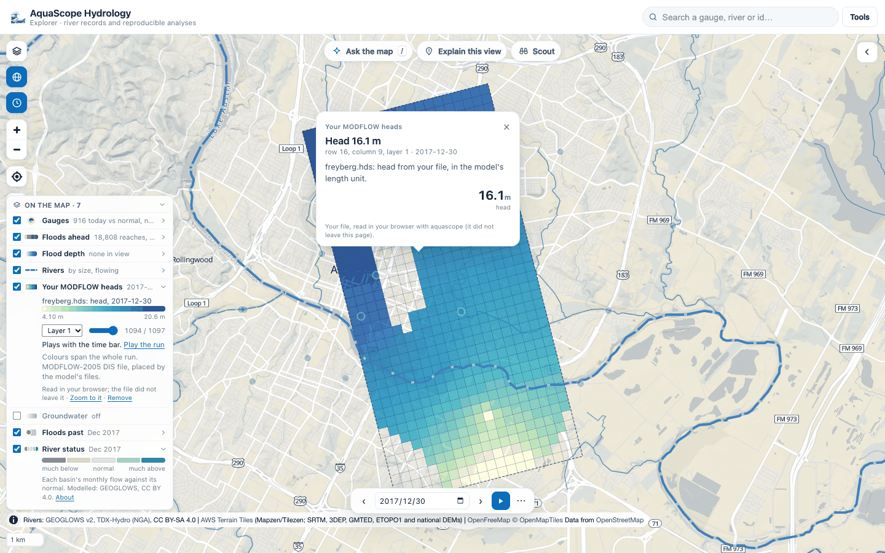

# MODFLOW heads on the map

`aquascope.groundwater.surface.read_modflow_heads` reads a MODFLOW binary head file and
places its cells on the Earth, so a model's heads can be drawn on a map, the way ModelMuse,
FloPy and GMS show them. The Explorer uses it when you drop a model on the globe, and the
CLI and the MCP server expose the same function.



## What it reads

- **Heads**: the binary head file (`.hds`, `.hed`, `.bhd`) of MODFLOW-2005 or MODFLOW 6,
  single or double precision, any number of layers and time steps. A drawdown file reads
  the same way. Each record is a 44-byte header in single precision (52 in double:
  `kstp, kper, pertim, totim`, a 16-character text, `ncol, nrow, ilay`), then
  `nrow * ncol` values; the precision is told from the first header. Inactive and dry
  cells (|h| of 1e20 and more, or -999.99 and the like) have no head. Unstructured
  (DISU) files are not read.
- **The grid**, from one of:
  - a MODFLOW 6 `.dis` or `.disv` text file (`DELR` and `DELC` as `CONSTANT` or
    `INTERNAL`; `XORIGIN`, `YORIGIN`, `ANGROT`, `LENGTH_UNITS` from its options),
  - a MODFLOW-2005 `.dis` (with FloPy's georeference comment when it has one),
  - a MODFLOW 6 binary grid file (`.dis.grb` or `.disv.grb`), which holds every array
    whatever the input used, so it is the way round `OPEN/CLOSE` arrays,
  - or a cell size, for a regular grid.
- **Where and when**, when the grid does not say: a `.nam` with the comment FloPy writes
  (`xul`/`yul` or `xll`/`yll`, `rotation`, `proj4_str` or `epsg`, `start_datetime`), a
  MODFLOW 6 `.tdis` (`TIME_UNITS`, `START_DATE_TIME`), or what you type: the lower-left
  corner, the rotation (degrees counter-clockwise) and the CRS (an EPSG code).

Cells come back as polygons in lon/lat (projected with pyproj) and heads as an array of
time x layer x cell. A DIS grid with more than 60,000 cells per layer is drawn in blocks
of k x k cells (their mean head), and the result says so; a DISV grid that large is
refused.

## Checked against FloPy

On FloPy's own examples (CC0, `examples/data/mf6-freyberg` and
`examples/data/freyberg_multilayer_transient`, read on 2026-10-11, not committed) the
heads are identical to `flopy.utils.HeadFile`'s, value for value, in single and double
precision (one time step on one layer, and 1,097 time steps on three layers), and the
placed corners match FloPy's `StructuredGrid` with the same origin and rotation. A test
compares the two on synthetic files wherever FloPy is installed.

Why not FloPy itself: FloPy 3.11.0 installs with micropip in the Explorer's Pyodide 314
and reads a `.hds` there (checked on 2026-10-11). But `import flopy` imports matplotlib,
so the page would download about 10 MB more (matplotlib 7.0 MB, fonttools 1.2 MB,
Pillow 1.0 MB, the FloPy wheel 1.5 MB, and a few small ones) to read a file whose layout
fits on a page. The reader here is plain numpy and imports on a bare install.

## Use it

In the Explorer: drop the `.hds` with its grid (and the `.nam` if FloPy wrote one) on the
map, or **Groundwater** in the legend, then **Your MODFLOW heads**. The files are read in
your browser's worker and do not leave it. Pick the layer, step through the times with the
slider, or play the run with the time bar when the model has dates. A click on a cell
gives its head. See [the Explorer](explorer.md#groundwater).

```bash
aquascope modflow model.hds --grid model.dis.grb --crs EPSG:27700 --origin 450000 120000
aquascope modflow freyberg.hds --grid freyberg.dis --sidecar freyberg.nam --layer 2 --geojson heads.geojson
aquascope modflow heads.hds --cell-size 100 --origin 0 0 --crs EPSG:32631 --start-date 2020-01-01
```

```python
from aquascope.groundwater.surface import modflow_geojson, modflow_summary, read_modflow_heads

res = read_modflow_heads("freyberg.hds", "freyberg.dis", sidecars=["freyberg.nam"])
modflow_summary(res, time_index=-1, layer=1)    # the grid, times, dates, range and one frame, JSON-safe
modflow_geojson(res, time_index=0, layer=3)     # that frame's cells with their head
```

The MCP tool `modflow_heads(hds_path, grid_path, ...)` returns the summary and, with
`geojson=True`, the frame's cells. When the model's place is unknown the answer says what
is missing (`needs`: `grid`, `origin`, `crs`).

What it is not: a model run. It reads what MODFLOW wrote; heads are in the model's own
length unit.
