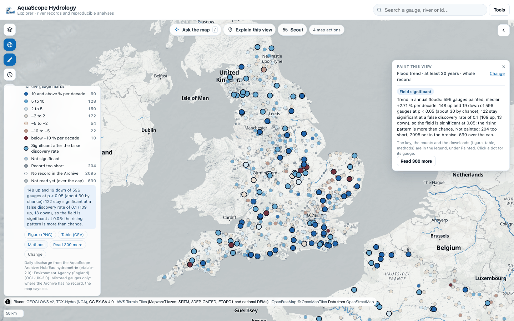
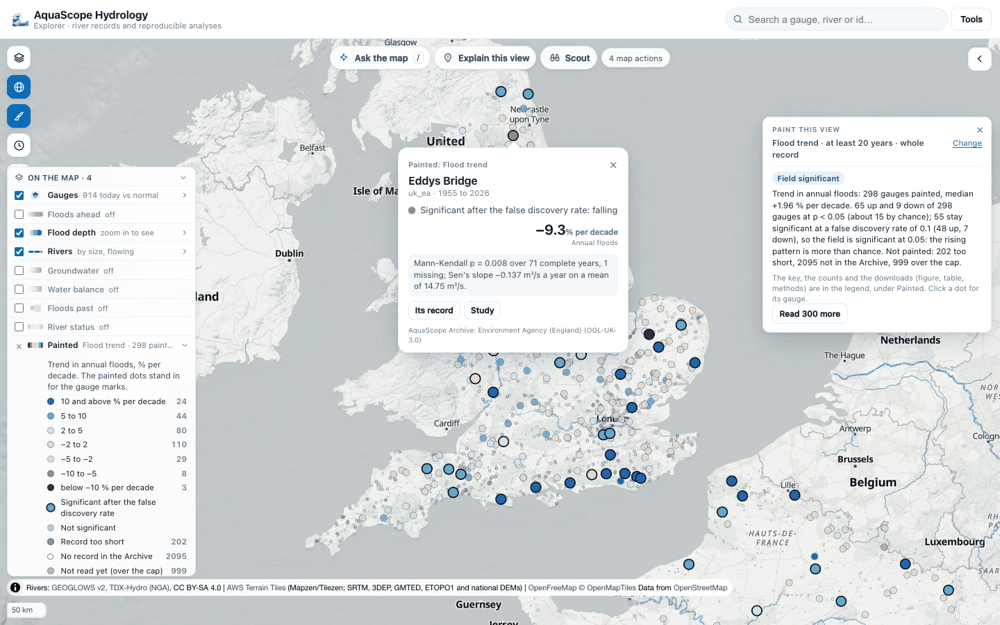
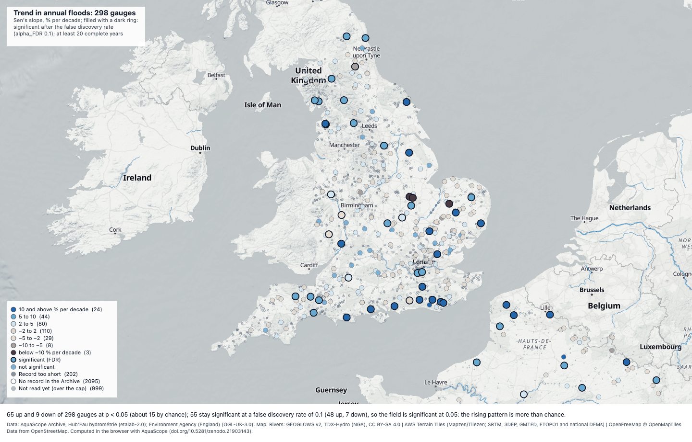

# Paint the globe: one question at every gauge in view

*Experimental (#657, part of #664). `aquascope.paint`, `aquascope paint`, the MCP tool `paint_map`, the
Explorer's "Paint this view" and the map action `paint`.*

A study answers for one place. Hydrologists publish maps of answers: are floods getting bigger across a
country? Paint the globe asks one question of every gauge in view that the AquaScope Archive mirrors, paints
each gauge with its answer, and says whether the pattern as a whole is more than chance.



## On the map

1. Click the brush in the map tools (left), pick a question and press **Paint this view**. Or ask the map:
   "paint the flood trend", "where are floods getting bigger in Europe?", "map low-flow trends in France".
2. The page reads each gauge's daily file from the Archive, ten at a time, and the worker answers them in
   batches of eight: the dots appear within seconds and fill in as the files land. The panel folds to one
   line with a progress bar and a Stop.
3. When it is done the legend's **Painted** row holds the key with a count per class, the field verdict and the
   downloads. The panel says the verdict in one chip.
4. Click a dot for its card: its number, the Mann-Kendall p-value, the years used and whether it survives the
   false discovery rate, with **Its record** (the gauge's panel) and **Study**.
5. **Read 300 more** reads the next gauges past the cap. Undo in the map actions log puts back the painting
   before (or none).

The painted dots stand in for the gauge marks while a painting is on. A filled dot with a dark ring is
significant after the false discovery rate; a smaller dot with a thin ring is not. The gauges that are not
painted stay on the map, small and grey, so the map says where it has no answer:

| Mark | Meaning |
|---|---|
| small grey dot | the record is shorter than the minimum |
| small grey ring | the Archive does not mirror this gauge |
| small light dot | not read yet: past the per-view cap (300 on a desktop, 120 on a phone), shortest records last |
| orange ring | the Archive file could not be read |



## The questions

One registry (`aquascope.paint.QUESTIONS`), each question a plain function of one gauge:

| Question | Value | Per gauge |
|---|---|---|
| `flood_trend` | Sen's slope of the annual maximum daily flow, % of its mean per decade | p-value, tau, years used, slope in m³/s a year |
| `low_flow_trend` | Sen's slope of the annual minimum 7-day mean flow, % of its mean per decade | the same |
| `baseflow_index` | Lyne-Hollick baseflow index from `signatures.parquet` (no record is read) | years in the Archive |

Planned next, plugging into the same registry: the 100-year flood per km² and GEOGLOWS against the gauge (KGE).

### The trend questions

- **Years.** Hydrological years: October to September north of the equator and April to March south of it for
  floods; for low flows the climate year, April to March in the north and October to September in the south,
  so a dry season is never cut in two. A year is named by the calendar year it ends in.
- **Complete years only.** A year counts when at least 330 of its days (about 90 %) have a daily mean.
- **Minimum record.** 20 complete years by default; 10, 30 or 50 in the picker, `--min-years` on the CLI.
- **Period.** The whole record by default, or the years from 1960 or 1980 on (`--start-year`, `--end-year`).
- **Trend.** The Mann-Kendall test (Mann, 1945; Kendall, 1975) on the annual series, with the package's own
  `mann_kendall`. Its size is Sen's (1968) slope against the year (a missing year stays a gap in time), divided
  by the series mean and given per decade.
- **Field significance.** The Benjamini-Hochberg false discovery rate (Benjamini and Hochberg, 1995) over the
  painted gauges' p-values at `alpha_FDR = 2 alpha_global` (`alpha_global` = 0.05), which Wilks (2016)
  recommends when the tests are spatially correlated, as gauges in one region are. The field is significant
  at `alpha_global` when at least one gauge survives. `--independent` uses `alpha_FDR = alpha_global`.
- **What it does not say.** A trend is not a cause (climate, land use, dams or a new rating curve can each make
  one), and the false discovery rate does not make one gauge's test stronger.

### Coverage

Only the Archive is read, never an agency live, so painting 300 gauges costs no agency anything. The Archive
mirrors about 4,000 discharge gauges, most of them in the United States, the United Kingdom, France and Poland
([Archive](archive.md)). Elsewhere the map shows grey rings, not a guess.

## Downloads

From the legend's Painted row:

- **Figure (PNG)**: the map as drawn, with a title, the key and its counts, the field verdict and the credits
  (the data's licences and the basemap's).
- **Table (CSV)**: one row per gauge in view, painted or not, with the value, p, `fdr_significant`, the years
  used and the reason a gauge was not painted.
- **Methods**: a methods paragraph, filled in with this painting's numbers, and its references.



## The same engine on the command line and for an assistant

```bash
aquascope paint --bbox=-8,49.8,2,59                       # flood trend over England, Wales and northern France
aquascope paint --bbox=-8,49.8,2,59 --question low_flow_trend --start-year 1970 -o lowflow.csv
aquascope paint --bbox=-8,49.8,2,59 -o methods.txt        # the methods paragraph and its references
```

The MCP tool `paint_map(bbox, question, min_years, start_year, end_year, max_gauges)` returns the same result
without the GeoJSON. In Python:

```python
from aquascope import paint

res = paint.paint("flood_trend", bbox=[-8, 49.8, 2, 59])
print(res["field"]["verdict"])
print(res["methods"])
```

## The check

**Against the package's own single-station trend, five Archive gauges.** With calendar years and the
single-station study's completeness rule (292 days), `paint.flood_trend` returns the same annual maxima, value
for value, and the same Mann-Kendall p-value and sample size at full precision (asserted), and the same tau.
Sen's slope on positions equals the single-station `sens_slope_per_year` exactly; Paint's slope against the
year differs only where years are missing (the single-station slope counts the step over a gap as one year):

| Gauge | Years | Missing | p (station) | p (paint) | Sen per step, station | per step, paint | per year, paint |
|---|---|---|---|---|---|---|---|
| usgs/USGS-01049500 | 122 | 13 | 0.1721 | 0.1721 | −0.0765 | −0.07647 | −0.06716 |
| usgs/USGS-01335754 | 117 | 21 | 0.1268 | 0.1268 | −1.3921 | −1.392 | −1.091 |
| uk_ea/001fc3f6-5980-42be-b553-6a09c6b69b69 | 28 | 0 | 0.2281 | 0.2281 | 0.2776 | 0.2776 | 0.2776 |
| hubeau_hydrometrie/A348020001 | 107 | 2 | 0.4334 | 0.4334 | 0.0594 | 0.05937 | 0.05893 |
| poland_imgw/149180020 | 75 | 0 | 0.1986 | 0.1986 | −0.9655 | −0.9655 | −0.9655 |

(Archive as of 27 October 2026. `tests/test_paint.py` repeats the check on synthetic records, with and without
missing years.)

**A region against a published result.** Flood trend over England, Wales and northern France (box 8.0°W to
2.0°E, 49.8°N to 59.0°N, the 300 longest Archive records with at least 20 complete water years): 298 gauges
tested, median +2.5 % per decade; 65 up and 11 down at p < 0.05 where about 15 are expected by chance; 56
survive the false discovery rate at 0.10 (47 up, 9 down), so the field is significant at 0.05. Blöschl and
others (2019) found increasing river floods in north-western Europe over 1960 to 2010. The direction agrees.
This is a qualitative comparison, not a reproduction: the gauges and the period differ.

## References

- Benjamini, Y., & Hochberg, Y. (1995). Controlling the false discovery rate: a practical and powerful approach to
  multiple testing. Journal of the Royal Statistical Society B, 57(1), 289-300.
- Blöschl, G., et al. (2019). Changing climate both increases and decreases European river floods. Nature,
  573, 108-111. https://doi.org/10.1038/s41586-019-1495-6
- Kendall, M. G. (1975). Rank Correlation Methods (4th ed.). Charles Griffin, London.
- Lyne, V., & Hollick, M. (1979). Stochastic time-variable rainfall-runoff modelling. Institution of Engineers
  Australia National Conference, Perth, 89-93.
- Mann, H. B. (1945). Nonparametric tests against trend. Econometrica, 13(3), 245-259.
- Sen, P. K. (1968). Estimates of the regression coefficient based on Kendall's tau. Journal of the American
  Statistical Association, 63(324), 1379-1389.
- Wilks, D. S. (2016). "The stippling shows statistically significant grid points": how research results are
  routinely overstated and overinterpreted, and what to do about it. Bulletin of the American Meteorological
  Society, 97(12), 2263-2273. https://doi.org/10.1175/BAMS-D-15-00267.1
