# Replay an event: a past flood as a story on the map

**Experimental** ([#659](https://github.com/Rekin226/aquascope/issues/659), part of
[#664](https://github.com/Rekin226/aquascope/issues/664)). Click a flood in Floods past, or a river reach with a date,
and press **Replay**. AquaScope gathers what the open data says about that flood and plays it on the map: the camera
flies from the rain over the basin, to the gauge against the model, to what the forecast said a week, three days and a
day before, down the river with the wave, and into the valley as Flood it floods it at the peak flow, with what was
under the water. The note at the bottom says what each stop shows. **Every number in a note is written by code from
the data; no model writes one.**

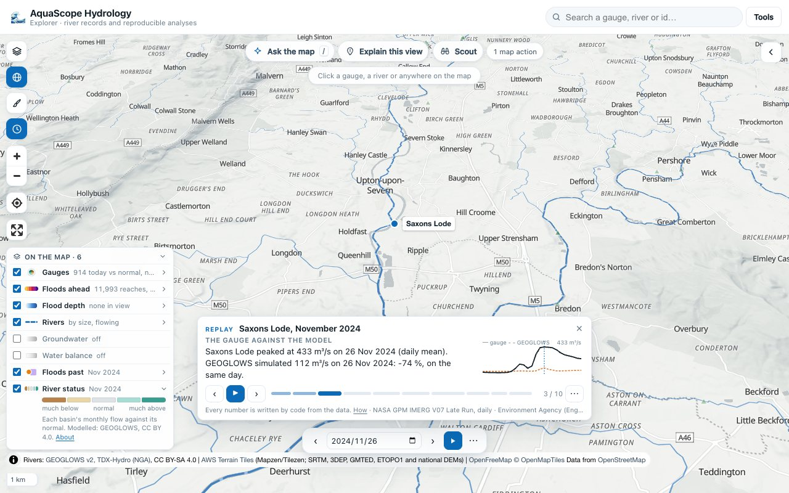

## What you do

1. **Find the flood.** In **Floods past**, click a news circle (from zoom 6): its card lists the floods its reports
   make, grouped into runs of days, most reported first, each with **Replay**. Or click a river, press **Replay** on
   its card and give a date (the map's by default); the floods in the news there that month are offered too.
   A card covers its cell's months: with no range on the time bar that is the twelve months up to the map's date, so
   the most reported flood of the year comes first; stepping the time bar by month keeps the card to one month.
2. **Watch.** The pieces are read (about two minutes the first time: the engine starts, then the gauges, the rain, the
   forecast archive and the wave), then the story plays. **Play** and **pause**, **‹ ›** (or the arrow keys) step
   between stops, and the scrubber jumps to any stop. The time bar moves with the story.
3. **Export or share.** Behind **⋯**: **Make a GIF** (one frame a stop, the note and the credits on each), **Record a
   video** (WebM, where the browser has MediaRecorder), **The report** (Markdown with every number, its source, its
   licence and its coverage) and **Copy the link** (`#rp=river_id,start,end,lat,lon,reports`, which replays the same
   story on a fresh page: the reach it was made on, the window, the place and, for a Floods past event, its number of
   news reports). Both were checked headless (Chrome, 2026-10-28): the video of the Severn's ten stops is a 44 MB WebM
   (VP9) in about two minutes, and the link, opened on a fresh page, plays the same ten stops with the same notes.
   The Floods past card is kept inside the map as its events and Replay buttons arrive.

Ask the map does the same from words: "replay the Severn flood of November 2024", "replay the flood of September 2024
at Asheville", "replay the November 2024 flood here". The model, when one is used, picks the place and the month; the
code lists the floods Floods past has there and takes the most reported (`pick` takes another), builds the story and
writes every number. Every replay is an entry in the undo log.

| | |
| --- | --- |
| 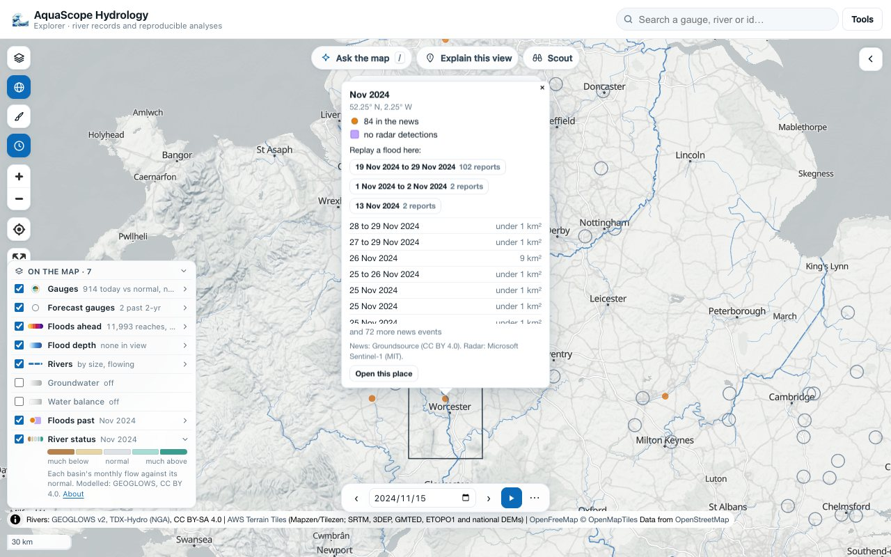 | 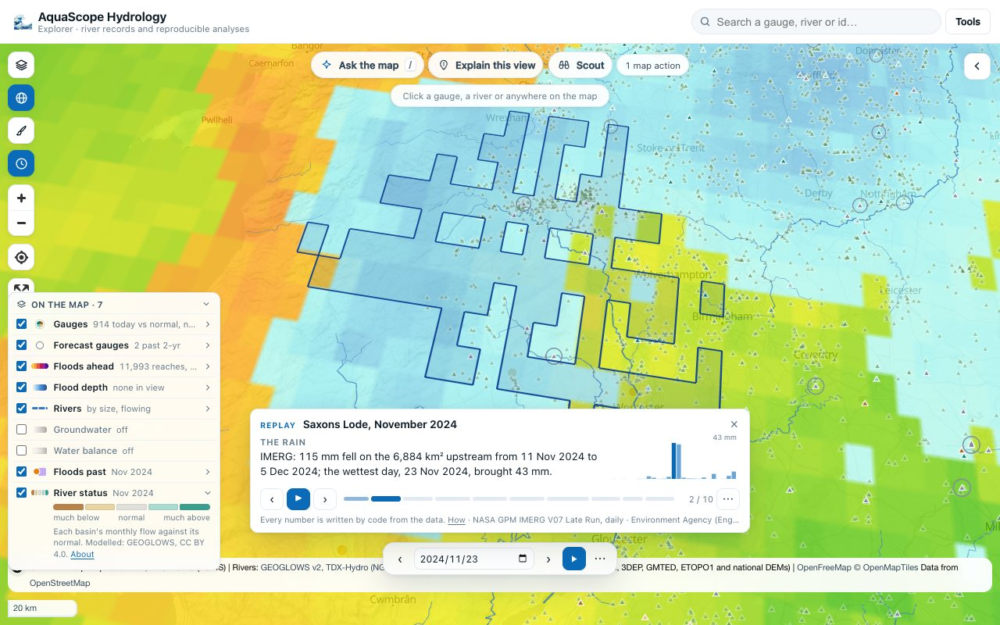 |
| 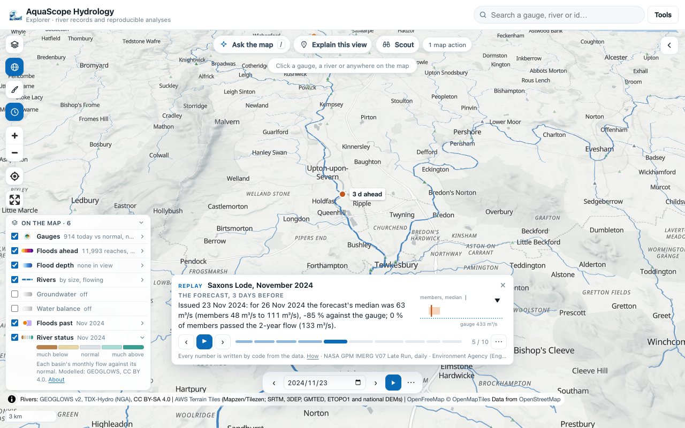 | 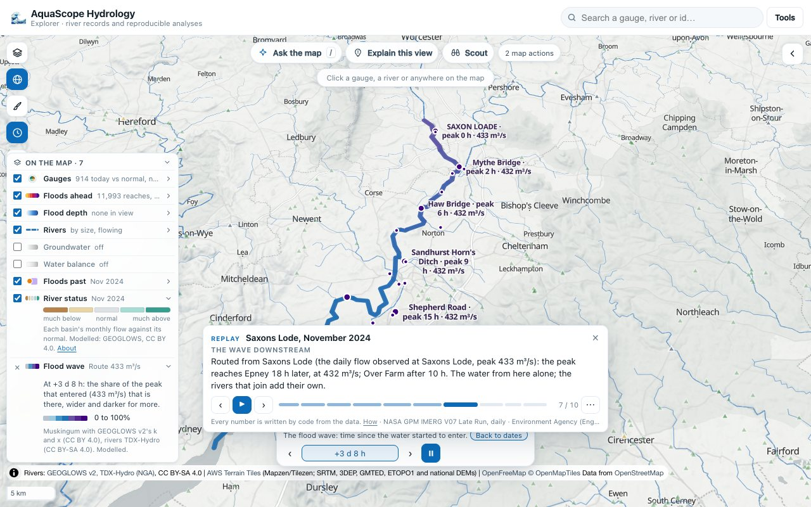 |
| 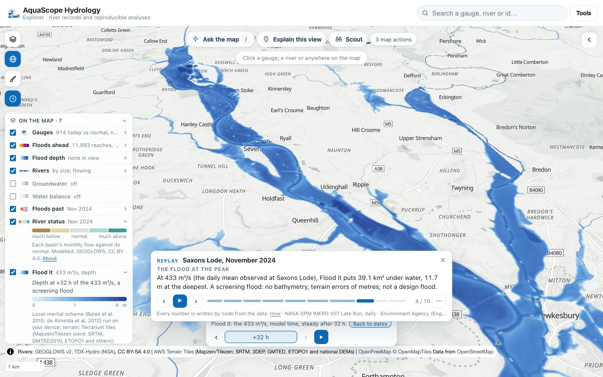 | 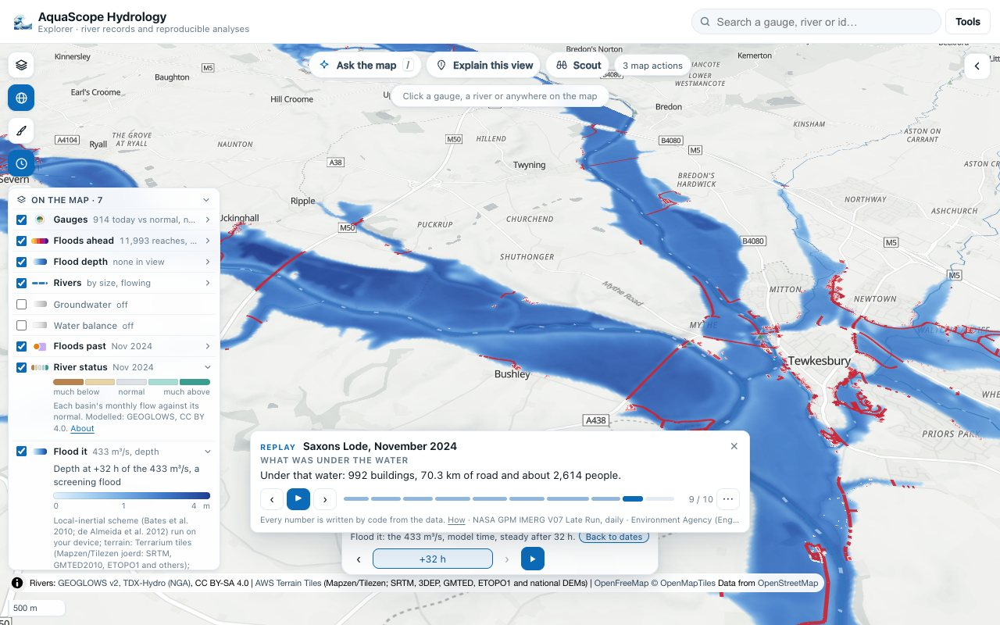 |
| 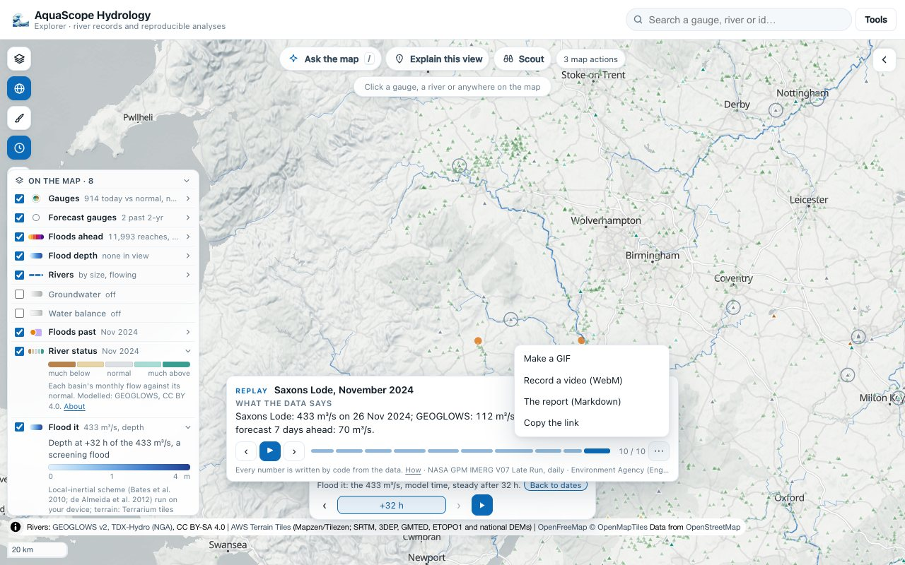 | 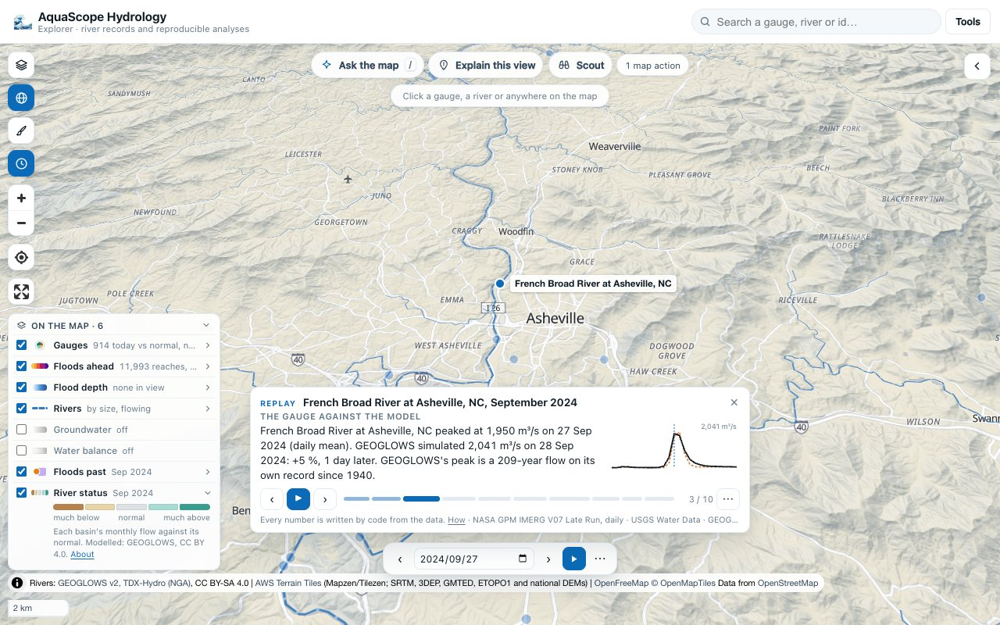 |
| 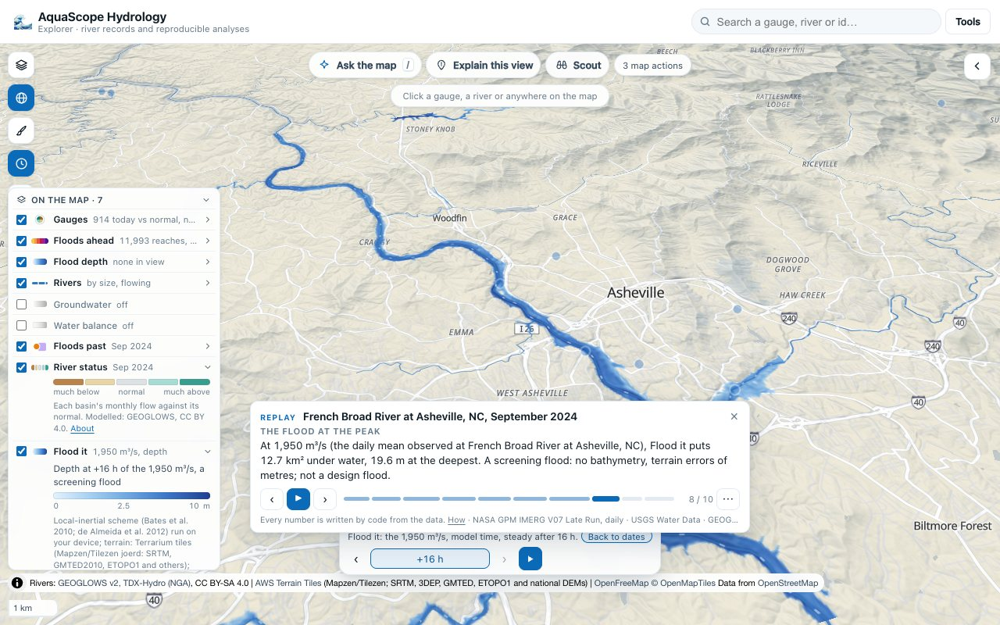 | 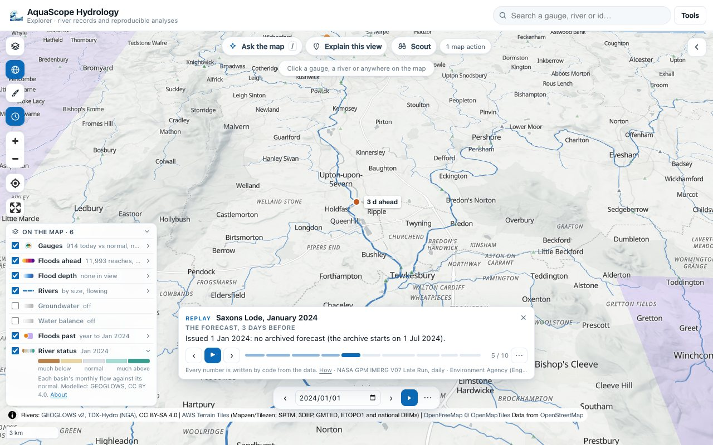 |

On a phone the note is a sheet at the bottom and the camera keeps the subject above it:

| | | | | |
| --- | --- | --- | --- | --- |
| 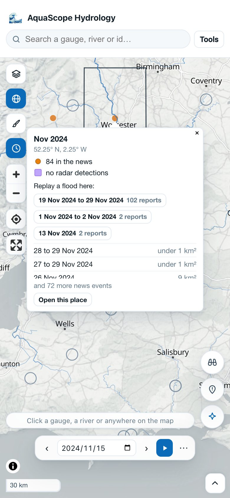 | 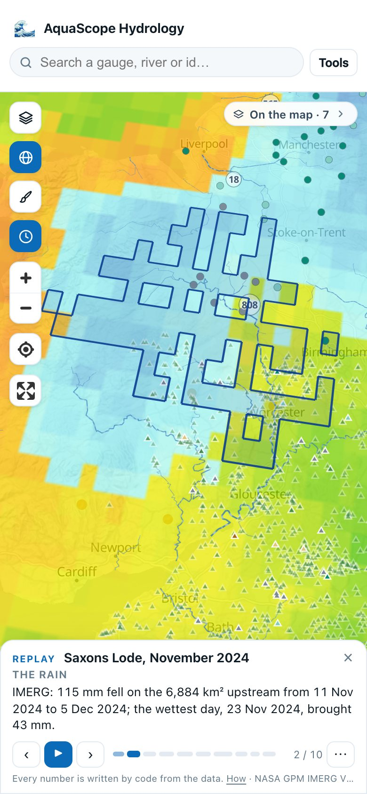 | 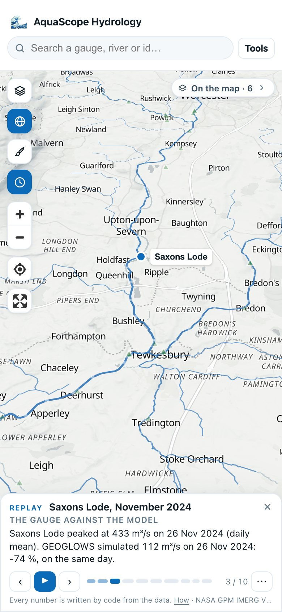 | 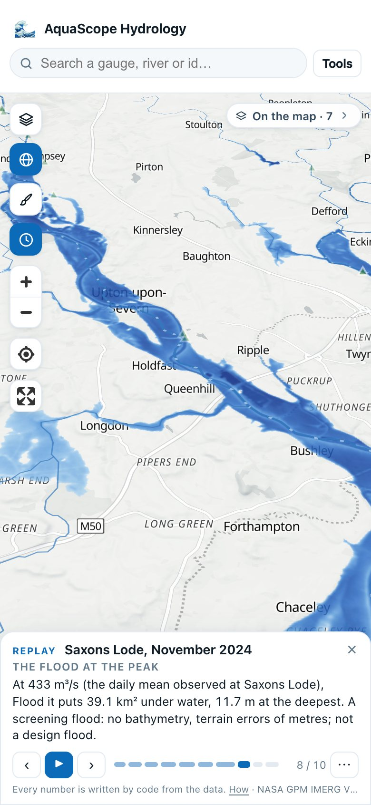 | 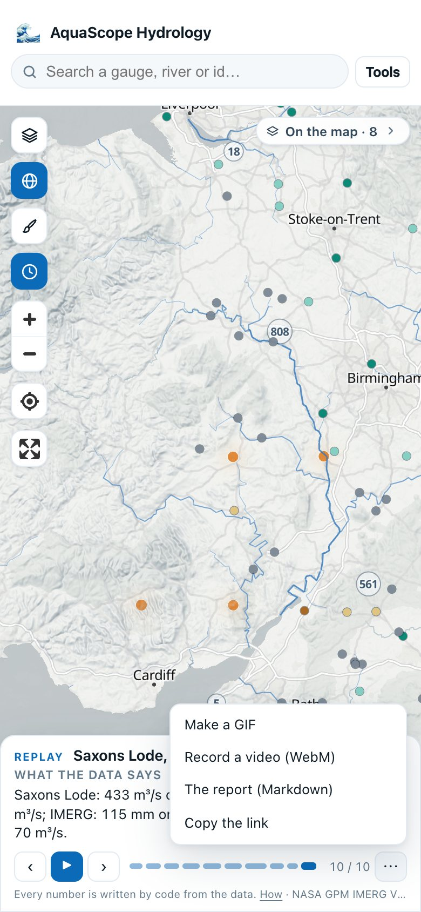 |

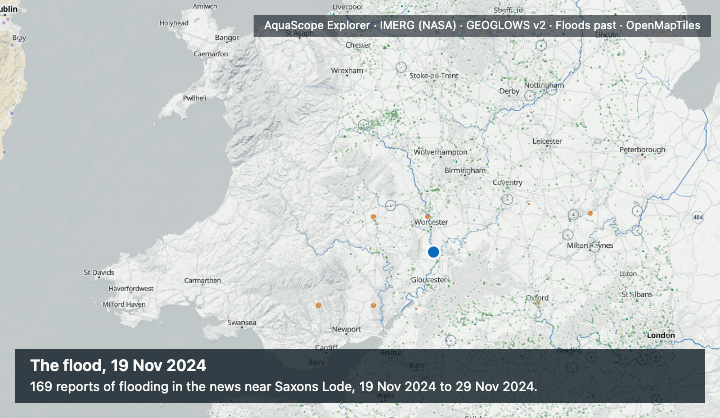

## What is assembled

`aquascope.replay.event_record` gathers each piece. Each carries its source, licence and coverage, and says plainly
when it is not available (the story then says so at that stop and goes on).

- **The event and the river.** A Floods past candidate (`candidates`: the Groundsource news reports within 40 km in the
  month, grouped into runs of days, a gap of more than two days starting a new one) gives the dates and a centre; the
  river is the main river near it (`replay.main_river`): of GEOGLOWS's reaches within 25 km, the river with the largest
  upstream area, at its reach nearest the centre. A tributary nearer the centre is not taken for it: Storm Bert's
  191 reports in the 40 km around 52.05° N, 2.30° W centre on 52.09° N, 2.49° W, 11.9 km from a Strahler order 5
  stream and 18 km from the Severn; the Severn (6,992 km² there) is the river. Where the network cannot be read, the
  highest Strahler order within 12 km stands. The window read is 8 days
  before the first report to 6 after the last, at most 45 days.
- **The gauges.** The Archive's discharge gauges within 30 km, each snapped to the GEOGLOWS reach it stands on (by its
  catalogued catchment area where a tributary joins beside it), kept when that reach is on the event's river (its main
  stem up, or its path down, 80 reaches each way) and the gauge has a record in the window; at most three, nearest
  along the river first. For each: the observed daily peak, GEOGLOWS v2's simulated daily peak at the same reach, the
  peak error and the timing. The first gauge is the story's: its peak is the event's peak.
- **The rain.** NASA's IMERG V07 Late Run, daily, averaged over the upstream basin by NASA/USAID SERVIR's
  [ClimateSERV](https://climateserv.servirglobal.net/develop-api) (dataset 226, operation 5, the mean). The basin goes
  as the 0.1° cells holding the centre of a GEOGLOWS unit catchment upstream of the gauge's reach (coarser cells when
  that is more than 120 runs). A unit catchment's centre is GEOGLOWS's own, from its routing configuration (the
  area-weighted ERA5 grid points the catchment overlaps), so the basin's edge is good to about one 0.1° cell. The basin
  total and the wettest day; the rain layer on the map is IMERG too (GIBS).
- **The forecast.** What GEOGLOWS's ensemble, issued at 00 UTC 1, 3 and 7 days before the peak, said for the peak day,
  from GEOGLOWS's forecast archive on S3 (`s3://geoglows-v2-forecasts/YYYYMMDD00.zarr`, one Zarr per run). For each
  run: the 51 members' daily mean on the peak day (median, lowest, highest), the high-resolution run, the share of
  members at or above the reach's 2-year flow (Log-Pearson III on GEOGLOWS's annual maxima, as Flood it), and the
  median against the gauge. A reach is found in a run by a binary search on the region of each chunk's first id (the
  ids are stored processing unit after processing unit), then one chunk of 686 reaches (about 14 MB) is read.
- **The wave.** Route it (`aquascope.routing.route`, which now takes a real hydrograph, `inflow_cms`) routes the
  observed daily flow at the gauge, read hour by hour, from 6 days before the peak to 14 after, down the river with
  GEOGLOWS's own k and x, every reach starting at the first hour's flow. For each gauge and town on the path: when
  the peak passes, how long after it passed the gauge, and the flow. It is the water from the gauge alone; the rivers
  that join below add their own.
- **The flood.** Flood it at the observed daily peak at the gauge (on the visitor's GPU in the Explorer; numpy on cells
  of about 47 m in the CLI), and what is under its largest depth: buildings and road length (Overture Maps) and people
  (GHS-POP), counted as the flood views count them, inside the wet area's box (at most 900 km²). A screening flood: no
  bathymetry, terrain errors of metres; see [Flood it](floodsim.md).

## The story format

`aquascope.replay.story` writes the story, version 1 of `aquascope.story`. It is small on purpose, so that other parts
of AquaScope (Studio studies) can write one and the same player plays it:

```json
{
  "schema": "aquascope.story", "version": 1, "title": "Replay: Saxons Lode, November 2024",
  "event": {"river_id": 230567275, "lat": 52.0496, "lon": -2.2005, "start": "2024-11-19", "end": "2024-11-29",
            "peak_date": "2024-11-26", "name": "Saxons Lode, November 2024", "window": ["2024-11-11", "2024-12-05"]},
  "stops": [
    {"id": "gauge", "kind": "gauge", "title": "The gauge against the model",
     "camera": {"center": [-2.20047, 52.04958], "zoom": 11.2, "pitch": 50, "bearing": -20},
     "date": "2024-11-26", "layers": ["rivers"],
     "note": "Saxons Lode peaked at 433 m³/s on 26 Nov 2024 (daily mean). GEOGLOWS simulated 112 m³/s ...",
     "focus": {"lon": -2.2005, "lat": 52.0496}, "series": {"kind": "flow", "observed": [...], "modelled": [...]}}
  ],
  "sources": [{"piece": "rain", "available": true, "source": "...", "licence": "...", "coverage": "..."}],
  "made_by": "aquascope.replay"
}
```

- **Required on every stop:** `id`, `kind`, `title`, `camera` (`center` as [lon, lat], `zoom`, `pitch`, `bearing`),
  `date` (on the time bar, or null), `layers` (Ask the map's layer ids, plus `basin`, `route`, `floodsim`,
  `exposure`) and `note`.
- **Optional:** `focus` (a point to mark), `series` (a small chart beside the note), `basin` and `outline` (GeoJSON),
  `run` (what a forecast or a flood stop is about), and `template` with `needs` and `fill`: a note the page fills from
  its own computation (the Explorer runs Flood it on the GPU, so the flood and exposure notes are the package's
  templates filled with the run's numbers).
- **Readers refuse a version they do not know** (`explorer/src/replay-core.js` `checkStory`).

## The two events, checked

Both were replayed end to end from Floods past, in headless Chrome (WebGPU on Metal) and with the CLI, on 2026-10-27.
The numbers below are the code's; each is checked against its source.

### The Severn, Storm Bert, November 2024

`aquascope replay --at 51.95 -2.2 --month 2024-11` takes Floods past's most reported flood there (169 news reports
from 19 to 29 November, centred about 11 km west of the Severn), and the main river is the Severn at Upton (reach
230567275, 6,884 km² upstream, 10.8 km away).

| Piece | The note's number | Checked against | Result |
| --- | --- | --- | --- |
| Gauge | Saxons Lode, 433 m³/s on 26 Nov 2024 (daily mean, 432.61) | The Environment Agency's Hydrology API, the station's daily mean flow (`...-flow-m-86400-m3s-qualified`) | 432.609 m³/s on 26 Nov, the same; the EA marks these days "Suspect". Its daily maximum that day is 437.5 m³/s |
| Gauge | Deerhurst 567 m³/s, Haw Bridge 520 m³/s (28 Nov) | The Archive's daily record (EA) | the same days and values |
| Model | GEOGLOWS 112 m³/s on 26 Nov: -74 %, the same day | GEOGLOWS's API `retrospectivedaily/230567275` | the same; below the reach's own 2-year flow (133 m³/s). GEOGLOWS is low on the Severn's floods, as [Flood it's check](floodsim.md#why-flood-it-is-shallower) found |
| Rain | 114 mm on the 6,884 km² upstream, 11 Nov to 5 Dec; the wettest day 23 Nov, 42 mm (CLI; 115 mm and 43 mm in the browser, whose basin came out one strip of cells different, 0.8 % apart) | The basin's area against the EA's catchment area for Saxons Lode, 6,850 km² | 0.5 % apart. No independent basin total of IMERG was found to compare with |
| Forecast | Issued 25 Nov: median 63.42 m³/s for 26 Nov (members 62.68 to 64.73), high-res 63.56; issued 19 Nov: 69.87 (50.31 to 99.43) | The same runs read with xarray and zarr 3 (a reader independent of AquaScope's) | the same to the hundredth. No member reached the 2-year flow at any lead |
| Wave | The peak reaches Deerhurst after 5 h, Haw Bridge after 6 h, Epney after 18 h (433 m³/s at Saxons Lode, 432 at Epney) | The gauges' observed daily peaks | Deerhurst peaked the same day as Saxons Lode, consistent with 5 h. Haw Bridge peaked two days later (28 Nov); a daily record cannot resolve hours, and the tidal Severn below is not what Muskingum models |
| Flood | 38.8 km² under water, 14.7 m at the deepest (CLI, 47 m cells); 39.1 km² and 11.7 m on the GPU (24 m cells) | Flood it's own checks (floodsim.md) | the two grids agree on the area within 1 %; the deepest cell differs with the grid, a screening number |
| Exposure | 1,151 buildings, 71.3 km of road, about 2,602 people (CLI); 992, 70.3 km and 2,614 (GPU) | The flood views' count (aquascope.flood_exposure) | the counts differ with the grid's cell size; both are estimates |

### Hurricane Helene, the French Broad at Asheville, September 2024

`aquascope replay --at 35.58 -82.56 --month 2024-09`: 195 reports from 23 September to 3 October; the main river within
25 km is the French Broad (reach 760658432, 2,420 km² upstream); the nearest gauge on it with a record is the USGS gauge at Asheville
(03451500), on reach 760585214.

| Piece | The note's number | Checked against | Result |
| --- | --- | --- | --- |
| Gauge | 1,950 m³/s on 27 Sep 2024 (daily mean) | USGS NWIS daily values (`waterservices.usgs.gov/nwis/dv`, 00060) | 68,900 ft³/s = 1,951.0 m³/s; the collector's value is rounded to three figures. USGS's published annual peak (NWIS peak file) is 113,000 ft³/s (3,200 m³/s) at 16:38 that day, instantaneous: the daily mean is lower |
| Gauge | Marshall 2,090 m³/s on 27 Sep; Fletcher 1,360 on 28 Sep | the Archive / USGS daily values | the same |
| Model | GEOGLOWS 2,041 m³/s on 28 Sep: +5 %, a day later; a 209-year flow on its own record | GEOGLOWS's API at reach 760585214, and the reach's Log-Pearson III curve | the same |
| Rain | 320 mm on the 2,450 km² upstream, 15 Sep to 9 Oct; the wettest day 26 Sep, 134 mm | USGS's drainage area for 03451500, 945 mi² (2,448 km²) | 0.1 % apart |
| Forecast | Issued 26 Sep: median 242.63 m³/s for 27 Sep (members 118.0 to 446.56), high-res 314.6; issued 20 Sep: 6.59 (1.99 to 55.58) | The same runs read with xarray and zarr 3 | the same to the hundredth. One day ahead 16 % of members passed the 2-year flow (351 m³/s); the median was 88 % below the gauge |
| Wave | The peak reaches Marshall (30 km) after 19 h, Hot Springs after 33 h | The gauges' observed daily peaks | Marshall peaked on 27 Sep, the same day as Asheville: consistent at a daily step |
| Flood | 12.9 km² under water (CLI, 62 m cells), steady after 18 h | Flood it's own checks | a screening flood of a steep, narrow valley |
| Exposure | 941 buildings, 93.3 km of road, about 882 people (CLI) | The flood views' count | an estimate |

**What the checks do not cover.** The rain is IMERG's satellite estimate (the Late Run, not the gauge-adjusted Final
Run), averaged over cells that hold the basin's unit catchments, so its edge is 0.1° coarse. The model and the
forecast are checked to be read correctly, not to be right: the stories show how far they were from the gauges.

## The faces

- **The Explorer**: Replay in Floods past's cards and on a reach's or a gauge's card; the player, the exports and the
  link; Ask the map's `replay` action.
- **The CLI**: `aquascope replay RIVER_ID --start --end`, or `--at LAT LON --month YYYY-MM [--pick N]`
  (`--candidates` lists Floods past's floods there), `--no-flood` to leave out Flood it, `--out-dir`. It writes the
  record (`*-record.json`), the story (`*-story.json`) and the report (`*.md`). About four to five minutes with the
  flood, most of it the numpy flood and the forecast archive's chunks.
- **MCP**: `replay_candidates` and `replay_event` (the story and the report; `flood` runs Flood it; `out_dir` writes
  the files).

## Licences

Floods past: Groundsource news events (Google), CC BY 4.0; Microsoft AI for Good Sentinel-1 floods, MIT. Rain: NASA GPM
IMERG V07, NASA Earth science data, free and open without restriction, served by ClimateSERV (SERVIR, NASA and USAID),
whose API page states no terms (read 2026-10-27). Gauges: each agency's licence, as the Archive records it (Environment
Agency, Open Government Licence v3; USGS, public domain). Model and forecast: GEOGLOWS v2, CC BY 4.0. Routing: GEOGLOWS
v2 routing configuration, CC BY 4.0; river network TDX-Hydro (NGA), CC BY-SA 4.0. Flood it: see
[its licences](floodsim.md#licences). Buildings and roads: Overture Maps, ODbL 1.0. People: GHS-POP R2023A, CC BY 4.0.
