# The sketchpad: draw on the map and see it compute

The sketchpad is a short menu in the Explorer's map tools (the pencil under the brush). Each
tool draws something on the globe, runs a real computation in your browser on it, and draws
the answer back on the map: a wave travelling down the rivers, a flattened flood, a field of
contours. A small card holds the numbers, and on a phone it is a sheet at the bottom. Every
drawing and every run is an entry in the action log, with its undo. Nothing needs a key or a
server: the package runs in the page's worker (Pyodide), and the same functions are a CLI
verb and an MCP tool.

Part of [#664](https://github.com/Rekin226/aquascope/issues/664), "Make the map compute".
The modules are experimental (see [stability.md](stability.md)).

## Draw a storm

Draw an area, say how much rain falls on it and over how many hours, and watch the runoff
travel down every river below it ([#670](https://github.com/Rekin226/aquascope/issues/670)).

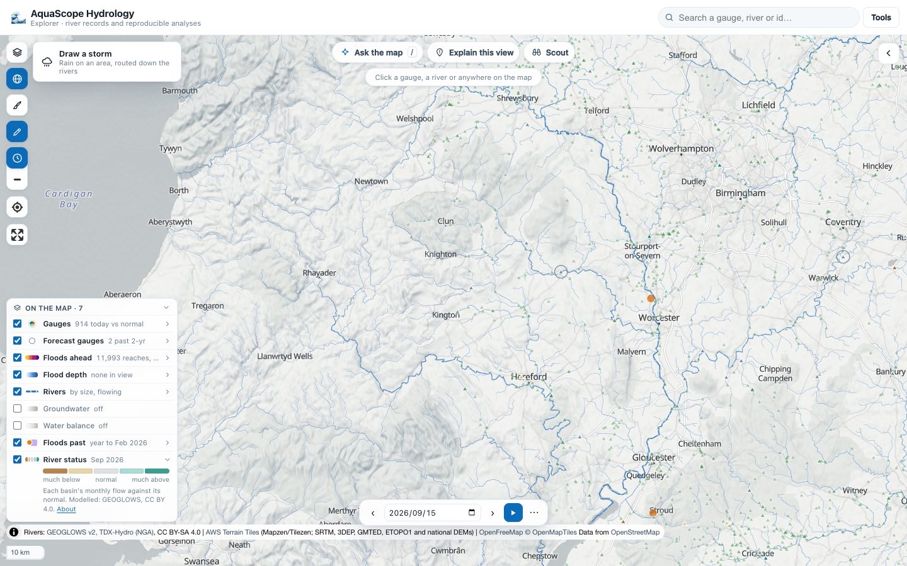

**Draw a storm** in the menu starts the drawing: tap the area's corners and press **Done**
(or Enter, or a double tap), or drag a box. The drawing tool is the one levees are drawn with
on Flood it's valley ([floodsim.md](floodsim.md#levees-and-breaches)), with an area instead of
a line.

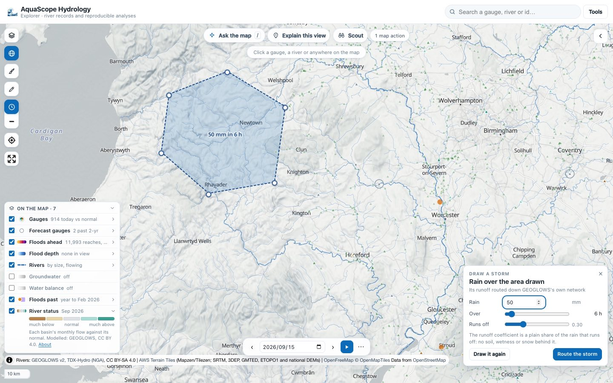

The card then asks for three numbers:

- **Rain**, in mm over the area (above 0, at most 2,000).
- **Over**, the hours it falls over (1 to 72 here; the package takes up to 720).
- **Runs off**, the runoff coefficient: the share of the rain that runs off, 0.3 by default.
  It is said plainly on the card because it is plain: a single number, the same on every
  catchment, with no soil, no wetness before the storm and no snow behind it.

**Route the storm** runs `aquascope.routing.route_storm` in the worker, the same function as
`aquascope route storm` and the MCP tool `route_storm`:

1. Every GEOGLOWS v2 reach whose unit catchment's centre (GEOGLOWS's ERA5 weight table) falls
   inside the area gets the runoff coefficient times the rain over its own unit catchment,
   spread evenly over the hours.
2. That runoff is routed down every river below with Muskingum, GEOGLOWS's own k and x per
   reach, hour by hour, until the wave has passed the last reach (Route it's engine; see
   [Route a flood](explorer.md#route-a-flood) and its check against GEOGLOWS's own
   retrospective).


The wave plays on the rivers with the time bar's own clock (hours since the rain started),
coloured and widened by the share of the biggest peak the storm adds that is there at that
hour, through Route it's own layers. **Back to dates** shows every reach at its own peak. A
click on a reach opens its card: the wave's front, its peak and the hour of the peak.

The card says, all from the package:

- the biggest flow the storm adds anywhere and the hour it peaks;
- the hydrographs of the reach that gets the most and of the main outlet, hour by hour;
- how many reaches and km² are under the storm, the runoff in m³, and the main outlet's peak;
- **Left by the outlets**: the share of the runoff that has left by the outlets by the end of
  the hours routed, the run's own mass balance;
- the rule used, in words ("0.3 of the rain runs off: 15 mm over each unit catchment under the
  storm, spread evenly over 6 h. A plain coefficient, no soil, wetness or snow.").

**Drag a corner** of the area and the storm is routed again from where it is now. The move
and the new run are each in the action log; undo takes back the run, then the move.

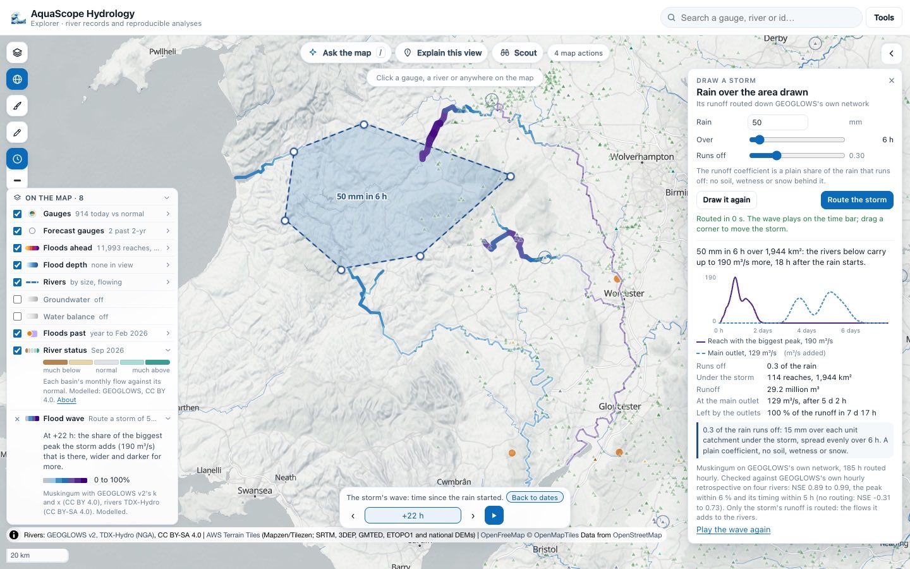


### From words

Ask the map reads a storm without a model: "50 mm of rain over this area in 6 hours", "draw a
storm of 80 mm over 12 h", "rain 100 mm on Wales in 2 days with a runoff coefficient of 0.5",
"what if 120 mm of rain fell here". The action is `draw_storm` in `aquascope.map_commands`:
`rain_mm` (required), `duration_h` and `runoff_coefficient` (route_storm's own defaults, 6 h
and 0.3, when the words do not say), and the area: `area: "drawn"` ("this area", "here": the
area on the map, or the reader draws one), a `polygon`, a `bbox` or a `place` (its outline from
the gazetteer). A model may pick it; the package computes it.


On a phone the menu opens beside the tools, the card hides while the area is drawn, and after a
run it is a short sheet at the bottom over the time bar, with the area and the wave above it.

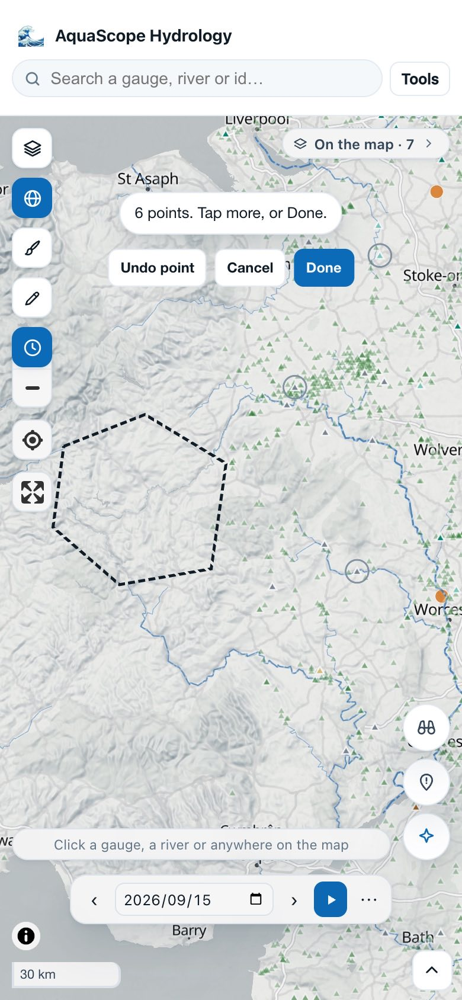
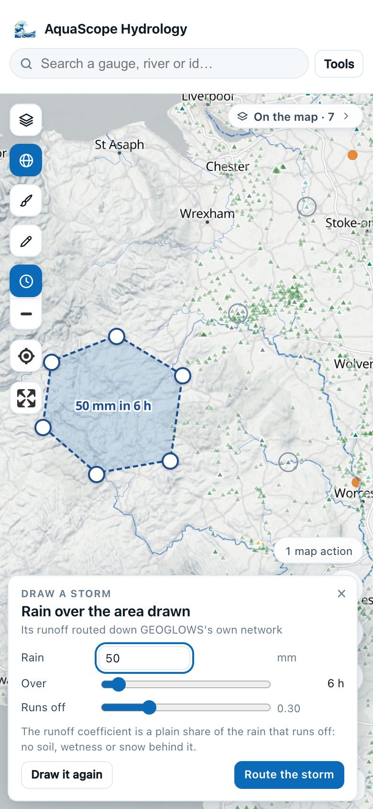
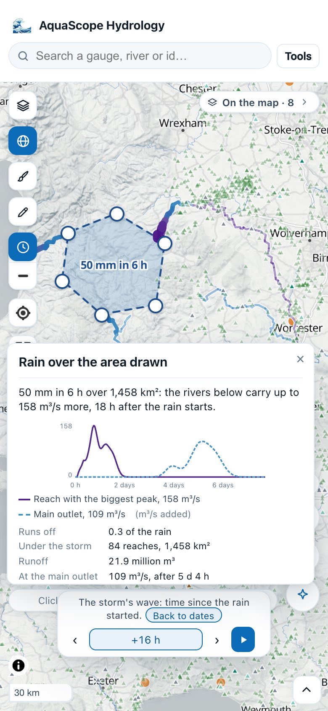

### The check

The routing is Route it's, checked against GEOGLOWS's own hourly retrospective on four rivers
(NSE 0.89 to 0.99, the peak within 6 % and its timing within 5 h; the table is in
[Route a flood](explorer.md#the-check-against-geoglowss-own-simulation)). What the storm adds
is checked by its water:

- **The runoff is the rain times the coefficient times the area.** Over mid-Wales (the area in
  the pictures), 50 mm and 0.3 over 84 reaches whose unit catchments add up to 1,457.6 km² is
  0.3 × 0.050 m × 1,457.6 km² = 21.9 million m³, the runoff the package reports.
- **All of it leaves.** Routed for 185 h, the outlets pass 21.9 million m³: 100 % of the
  runoff (Muskingum keeps mass; `tests/test_routing.py` checks the same on a small network to
  1 %).

The runoff coefficient is not a model of the soil, and the routing is the flow the storm adds
to whatever the rivers already carry: modelled, for the shape and the timing of a wave, not a
forecast.

### The CLI and MCP

    aquascope route storm --polygon '[[-3.78,52.62],[-3.45,52.70],[-3.12,52.58],[-3.18,52.32],[-3.55,52.28],[-3.82,52.42]]' --rain 50 --duration 6 --runoff 0.3

prints the same message; `--json` adds every number, the hydrographs and the mass balance. The
MCP tool `route_storm` returns the same as JSON.

## Draw a reservoir

Draw a lake across a river, set the dam, and watch it flatten a flood on its way down
([#662](https://github.com/Rekin226/aquascope/issues/662)).

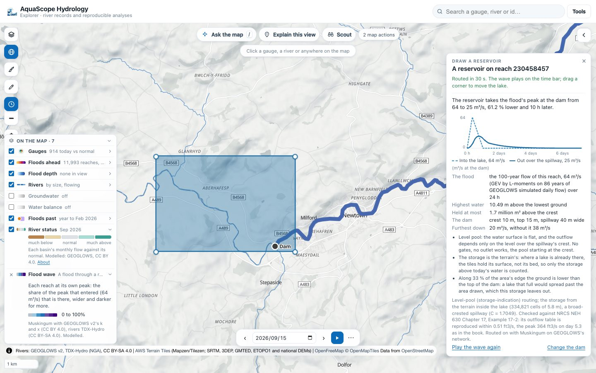

**Draw a reservoir** in the menu starts the same drawing tool: tap the lake's corners and
press **Done**, or drag a box. The worker finds the river and the dam
(`aquascope.sketch.reservoir.plan`):

- every GEOGLOWS reach whose line has a point inside the lake is in it (the stream tiles at
  zoom 12, where every reach is drawn);
- the river is the biggest of them (the highest Strahler order), and the dam is at its exit:
  the reach the most of the lake drains through, at the point of its line inside the lake
  nearest the reach below.

The page then reads the terrain under the lake from the Terrarium tiles (the same reader as
Flood it, at the finest zoom up to 14 that keeps the window to a million cells;
`Access-Control-Allow-Origin: *`, checked live), and the worker turns it into the lake's
stage-area and stage-storage curves (`stage_storage`): at each level above the lowest ground,
the cells below it and the volume `sum(level - ground)` over them. So yes, the terrain tiles
give a stage-area curve from the drawn area, and that is the storage used. Two limits are said
on the card: where a lake already exists the tiles hold its surface, not its bed, so only the
storage above today's water counts; and where the ground at the lake's edge is lower than the
top of the dam, a full lake would spread past the area drawn, which this storage leaves out
(the card gives the share of the edge).

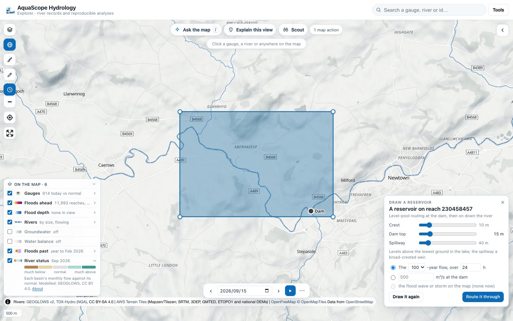

The card asks for the dam:

- **Crest**, the spillway's crest in m above the lowest ground: the pool starts there (full to
  the crest, the usual flood-routing start).
- **Top**, the top of the dam in m above the lowest ground: a flood that rises above it is said
  to overtop it.
- **Spillway**, its width in m. The outflow is a broad-crested weir, `Q = C b H^1.5` with
  `C = (2/3)^1.5 g^0.5`, about 1.705 in SI (critical depth over the crest, the ideal weir of
  the open-channel texts; `aquascope.floodsim.WEIR_C`, the one Flood it's breaches use).

These start at 10 m, 15 m and 30 m: illustrative, for you to set.

And the flood:

- **the T-year flow here**: the dam's reach's 2-, 10-, 25- or 100-year flow, a triangle over 24
  hours, entering at the dam. It is the same design flow as Flood it's and Route it's
  (`aquascope.floodsim.design_flow`): Log-Pearson III on GEOGLOWS v2's annual maxima of simulated
  daily flow since 1940 (`retrospective/maximums.zarr`, CC BY-NC-SA 4.0), so the same reach and
  the same T give the same m³/s in every tool;
- **a number** in m³/s;
- **the wave on the map**: a Route it flood from a reach upstream, or a drawn storm
  ([Draw a storm](#draw-a-storm)), routed down to the dam.

**Route it through** runs `route_reservoir`: Route it's Muskingum down GEOGLOWS's network, with
the dam's reach's outflow passed through the reservoir (`routing.route_network`'s `through`)
before it goes on. The wave on the time bar is the flattened one past the dam. The same run is
made without the reservoir, so the card says how much lower the peak is furthest down.


The card says, all from the package: the peak into the lake and out over the spillway, how much
lower and how much later; the highest water above the lowest ground (and whether it overtops
the dam); the most held above the crest; the peak furthest down with the reservoir and without
it; and the two hydrographs at the dam, hour by hour.

**Drag a corner** of the lake: the river and the terrain are found again, and after a run the
flood is routed through it again. The lake and every run are in the action log, each undoable.

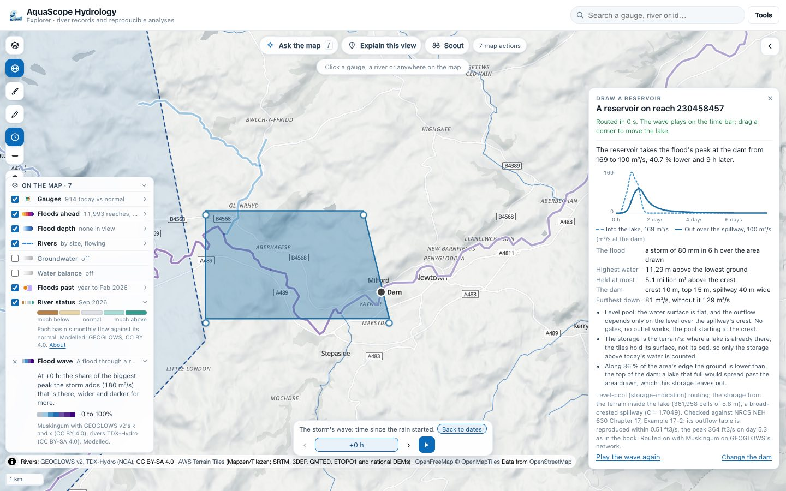


### From words

Ask the map reads a reservoir without a model: "draw a reservoir here", "draw a reservoir with a
40 m spillway at 12 m", "put a dam here and route the 100-year flood through it", "draw a
reservoir and send the wave through it". The action is `draw_reservoir` in
`aquascope.map_commands`: the lake (`area: "drawn"` or a `polygon`), `crest_m`, `top_m`,
`width_m` and the flood (`return_period`, `peak_cms`, or `inflow: "wave"`, the wave on the map).

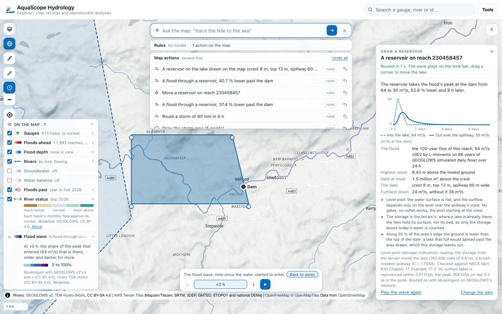

On a phone the card is the same short sheet at the bottom, with the lake and the dam above it. Reading
the terrain and routing took about 32 s in headless Chrome the first time (the terrain is then kept,
and a second run on the same lake took under a second).

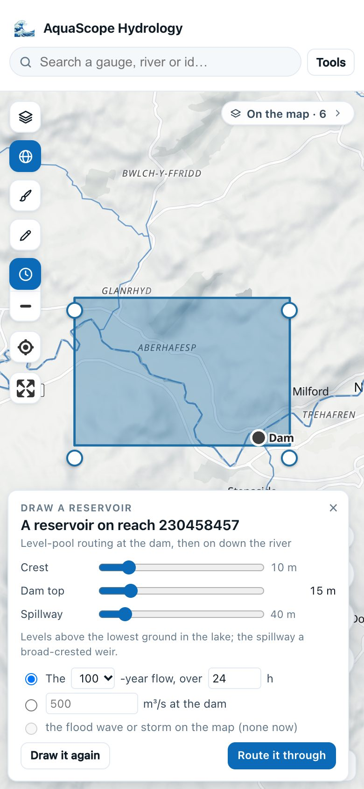
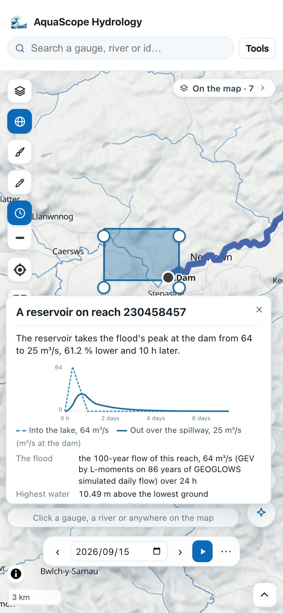

### The check

The method is checked against a textbook example: USDA NRCS, *National Engineering Handbook*,
Part 630 Hydrology, Chapter 17 "Flood Routing" (210-VI-NEH, Amend. 69, April 2014), Example
17-2, the storage-indication routing of a principal spillway hydrograph through a floodwater
retarding structure ([the chapter, a public PDF](https://directives.nrcs.usda.gov/sites/default/files2/1712930622/21209.pdf)).
`level_pool` takes the book's working curve (Table 17-11, p. 17-22: discharge in ft³/s against
storage above the first-stage crest in ft³/s-days) and its inflow (Table 17-12, p. 17-24), with
the book's own steps (0.5 day, 0.1 day from 4.5 to 6.0 days, then 0.5 day), from an empty pool.
Every outflow of Table 17-12 is reproduced within 0.51 ft³/s (the book rounds each step to a
whole ft³/s), and the peak is 364.2 ft³/s on day 5.3; the book's peak is 364 ft³/s on days 5.3
and 5.4. Some of the rows:

| Day | Inflow (ft³/s) | Book (ft³/s) | Here (ft³/s) |
| ---: | ---: | ---: | ---: |
| 4.5 | 245 | 115 | 115.5 |
| 5.0 | 2,002 | 212 | 212.5 |
| 5.1 | 1,049 | 358 | 358.2 |
| 5.3 | 393 | 364 | 364.2 |
| 6.0 | 164 | 355 | 354.9 |
| 6.5 | 138 | 249 | 249.2 |
| 10.0 | 67 | 120 | 120.2 |

`aquascope route reservoir --check` prints the whole table, and
`tests/test_sketch_reservoir.py` holds it to 1 ft³/s. Two more checks are in the tests: with a
linear reservoir (`S = K O`) the method is exactly the trapezoidal recursion
`O2 = ((2K - dt) O1 + dt (I1 + I2)) / (2K + dt)`; and the terrain's storage is the area times the
depth for a flat floor, and the V-shaped valley's width at each level.

### The CLI and MCP

    aquascope route reservoir --polygon '[[-3.40,52.505],[-3.34,52.505],[-3.34,52.53],[-3.40,52.53]]' --crest 10 --top 15 --width 40 --rp 100

reads the terrain tiles itself and prints the reservoir's numbers and the peak furthest down with
and without it (`--peak`, `--from RIVER_ID`, `--storm RING --rain MM`, `--json`); `--check`
prints the NEH table. The MCP tool `route_reservoir` returns the same as JSON.

On the Severn above Newtown (run on 2026-10-28) it writes: a reservoir of 11.318 km² on reach
230458457; the 100-year flow of the reach, 65 m³/s (Log-Pearson III on GEOGLOWS v2's annual maxima
of simulated daily flow, 1940 to 2024), over 24 h peaks at 65 m³/s at the dam after 8 h and leaves
at 25 m³/s after 18 h, 61.1 % lower and 10 h later; the water rises to 10.5 m above the lowest
ground, with 1,730,000 m³ held at most; furthest down (reach 230461752) the peak is 20 m³/s with the
reservoir and 38 m³/s without. Flood it reads the same 65 m³/s (64.6) as the 100-year flow of that
reach.

GEOGLOWS v2 routing configuration and retrospective, CC BY 4.0; river network TDX-Hydro (NGA), CC BY-SA 4.0,
shown and not republished. Terrain: Terrarium tiles (Mapzen/Tilezen joerd on AWS Open Data: SRTM, GMTED2010,
ETOPO1, national lidar and others; each tile names its sources).

## Drop a well

"What happens to the water table if I pump here?" **Drop a well** in the sketchpad's menu, then a click on the
map, drops a pumping well there. Its drawdown cone is drawn round it: contour lines at 5 cm (dashed, the cone's edge),
10 cm, 20 cm, 0.5 m, 1, 2, 5 m and deeper, over a fill that darkens with depth. Drop more wells and their cones add. Drag a well and
the cone follows as you drag; change a well's rate, the aquifer's transmissivity and storativity, or the days of
pumping, and it is computed again. **Play the cone growing** takes the time bar and plays the cone from 6 hours to the
days you chose.

A well's card gives its drawdown at its face (at the well's radius, 0.15 m by default, with no well loss), its own
share and what the other wells add there, and how far its 5 cm line reaches. A contour's card gives the drawdown
where you clicked and the nearest well. On a phone the panel is a sheet at the bottom, and a card takes its place
while it is open.


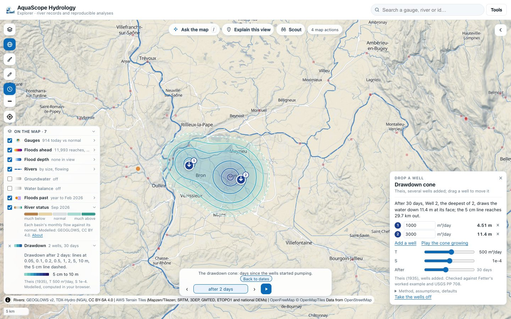

**With your MODFLOW model.** When MODFLOW heads are on the map ([MODFLOW heads on the map](modflow.md)) and a well is
dropped inside the model, its card names the model's cell under it, the cell's size and the layer shown, and what the
model's well cell would read instead of the well's own drawdown: the Theis drawdown at Peaceman's equivalent radius,
0.2 times the cell's side (Peaceman, 1978). A coarse cell averages the steep part of the cone; the card says by how
much.

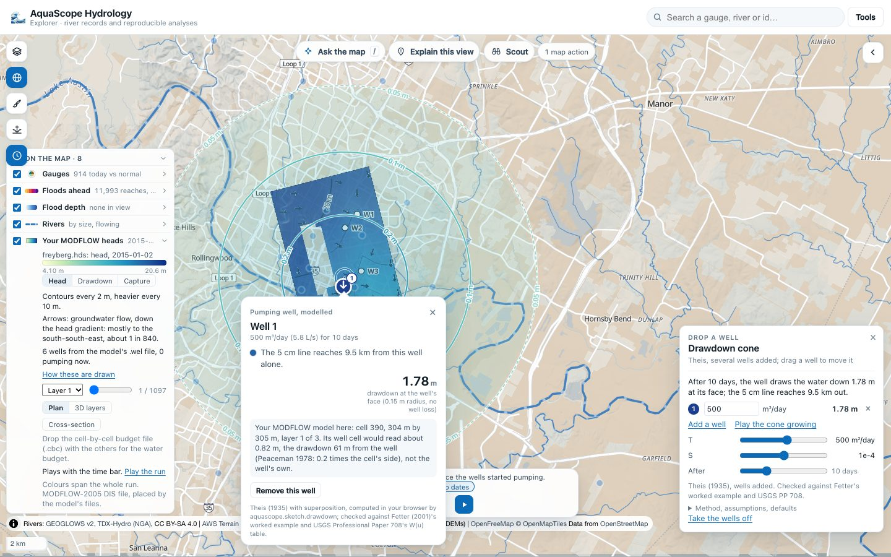

### The model

Theis (1935): the drawdown at a distance `r` from a well pumping `Q` for a time `t` in a confined aquifer of
transmissivity `T` and storativity `S` is

```
s = Q / (4 π T) · W(u),    u = r² S / (4 T t),    W(u) = E1(u)
```

Several wells add by superposition. The well function is `aquascope.groundwater.aquifer`'s, the engine behind
`aquascope groundwater --analysis theis` and the `aquifer_drawdown` tool, so there is one Theis in the package. The
cone is traced by marching squares on a grid that is even across the cone and closes in on every well geometrically,
so the tight circles near a well are as true as the wide ones far out. Distances are measured on a local plane around
the wells. The cone is cut 100 km from the wells.

**What it assumes**, and the panel says so: a confined aquifer, homogeneous, isotropic and of infinite extent; wells
that fully penetrate it and pump at a constant rate; water released from storage at once. No recharge, no rivers or
boundaries, no leakage, no delayed yield of a water table. A screening answer, not a well-field design.

**The defaults** are a municipal well in a confined sand aquifer: 1,000 m³/day (11.6 L/s), T = 500 m²/day,
S = 1e-4, read after 30 days. The typical ranges are from Heath (1983), USGS Water-Supply Paper 2220: the
transmissivity of principal aquifers ranges from less than 1 to 100,000 m²/day (p. 26), and the storage coefficient of
most confined aquifers from about 1e-5 to 1e-3 (p. 28). The panel's sliders reach past them, and say so when you do.

### The check

`aquascope well --check` recomputes these, and `tests/test_sketch_drawdown.py` holds them:

| Reference | Printed | Computed |
| --- | --- | --- |
| Fetter (2001), *Applied Hydrogeology*, 4th ed., the worked example of the Theis equation: K = 14.9 m/day over 20.1 m (T = 299 m²/day as printed), S = 0.0051, Q = 2725 m³/day, r = 7.0 m, t = 1 day | u = 0.00021, W(u) = 7.94, drawdown 5.7 m | u = 0.000209, drawdown 5.73 m |
| Lohman (1972), *Ground-water hydraulics*, USGS Professional Paper 708, Table 5, p. 16: W(u) for u = N × 10ᵏ, rows N = 1.0 and N = 2.0, k from -15 to 0 (32 values) | four decimals | every value within 1e-4 |
| Superposition: two equal wells 1 km apart | equal at mirror points, the same both ways | 2.4021 / 2.4021 m; 1.1290 / 1.1290 m |

Fetter reads W(u) from the table at u = 2 × 10⁻⁴ (7.94) where the inputs give u = 2.09 × 10⁻⁴ (W = 7.90); the book's
5.7 m and the code's 5.73 m agree to the two figures printed. PP 708 is at
<https://pubs.usgs.gov/pp/0708/report.pdf>; the superposition check also confirms that the wells pumped together give
the wells pumped alone, added.

### From words, a CLI and an agent

Ask the map reads "drop a well here", "drop a well at Lyon pumping 2000 m3/day" and "drill a borehole near Lille
pumping 20 l/s for 90 days" into the `drop_well` action without a model (a rate in L/s is turned into m³/day); the
place is looked up and the map computes the cone. The same function from a terminal and for an agent:

```bash
aquascope well --at 4.88 45.76 --at 4.92 45.765 --rate 1000 --rate 3000 --days 90 --geojson cone.geojson
aquascope well --check
```

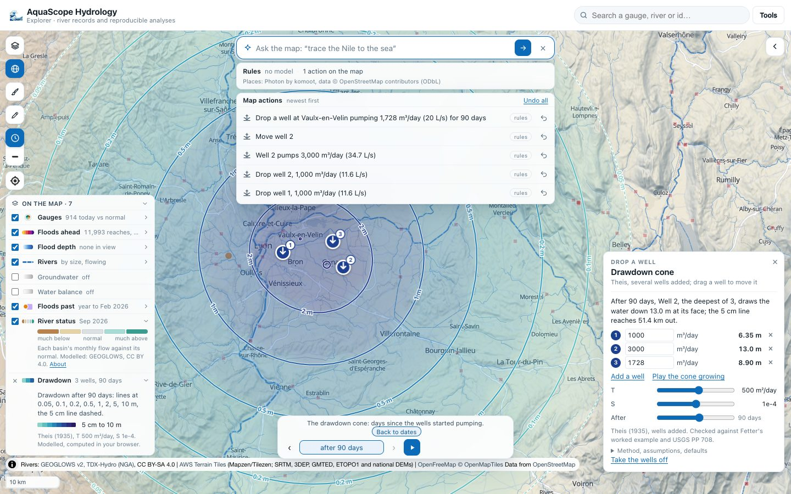

The MCP tool `drop_well` takes one well (`lon`, `lat`, `rate_m3_day`) or `wells`, and returns the same numbers and the
contours in lon/lat.


### References

- Theis, C.V. (1935). The relation between the lowering of the piezometric surface and the rate and duration of
  discharge of a well using ground-water storage. *Transactions, American Geophysical Union*, 16, 519-524.
- Fetter, C.W. (2001). *Applied Hydrogeology*, 4th edition. Prentice Hall.
- Lohman, S.W. (1972). *Ground-water hydraulics*. USGS Professional Paper 708.
- Heath, R.C. (1983). *Basic ground-water hydrology*. USGS Water-Supply Paper 2220.
- Peaceman, D.W. (1978). Interpretation of well-block pressures in numerical reservoir simulation. *SPE Journal*,
  18(3), 183-194. doi:10.2118/6893-PA.

## Change land use

"What if this area is built over?" **Change land use** in the sketchpad's menu draws an area (tap its corners and
press **Done**, or drag a box, with the levee and storm drawing tool), then asks what it becomes, the design storm
and, if you know it, the soil group. **Compute** reads what is under the area now, works out its runoff and its peak
flow before and after with the SCS curve number method, and draws the answer: the area filled in what it becomes and
labelled with its peak's change, the GEOGLOWS reach it drains to lit in orange, with the way to it. The panel (a sheet
on a phone) gives the curve number, the runoff, the time of concentration and the peak, now and after, the cover under
the area as a bar in WorldCover's colours, the soil groups, and every source with its licence. Drag a corner and it is
computed again. **Route the extra peak downstream** sends the added peak down the river with Route it, as a triangle
carrying the added runoff volume. Every change is in the undo log.

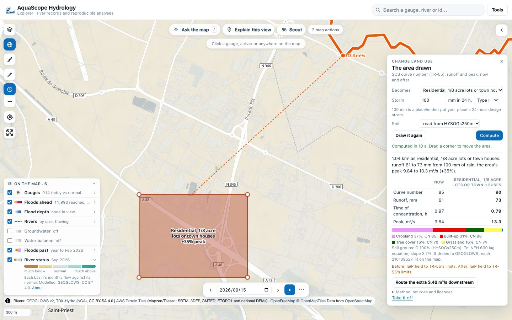

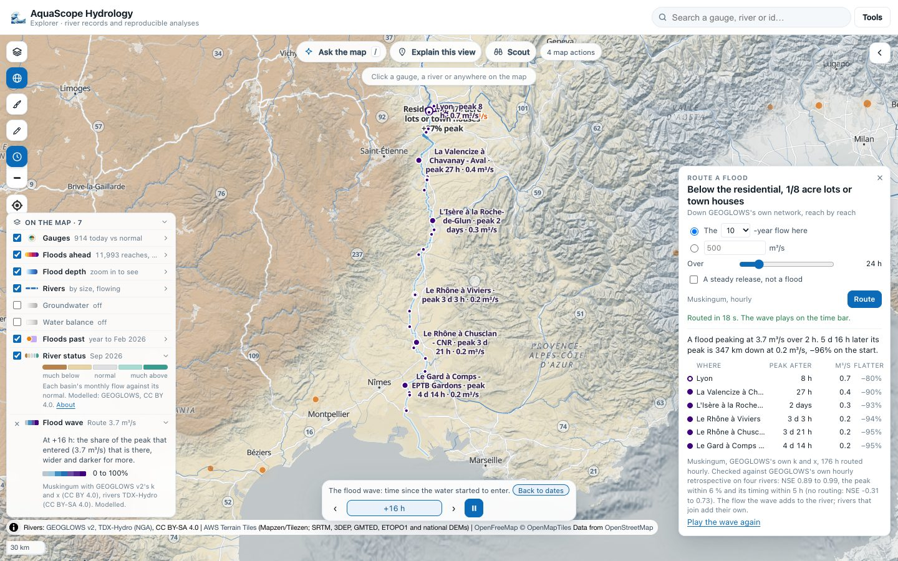

### The method

USDA's TR-55 (*Urban Hydrology for Small Watersheds*, second edition, June 1986):

- **Runoff**, equations 2-1 to 2-4: `Q = (P - 0.2S)² / (P + 0.8S)` for `P > 0.2S`, `S = 1000/CN - 10` (inches).
- **Curve numbers**, tables 2-2a to 2-2c, area-weighted; a share of impervious area with figure 2-3 (its equation is
  in appendix F).
- **Peak**, the graphical method of chapter 4: `qp = qu Am Q Fp`, `qu` from the equation behind exhibit 4 (appendix
  F, table F-1) for Tc and `Ia/P`, interpolated between the table's `Ia/P` rows and held at the limiting values outside
  them, as TR-55 recommends; `Fp`, the pond and swamp factor, from table 4-2.
- **Time of concentration**: the watershed lag method of NRCS's National Engineering Handbook, part 630, subpart F
  (amended June 2025), equation 630.15-4b, `Tc = l^0.8 (S + 1)^0.7 / (1140 Y^0.5)`, with the flow length from the
  area (equation 630.15-5, `l = 209 A^0.6`) and `Y` the average land slope read from the terrain, before and after
  (the curve number held to 50 to 95 there, as the handbook asks).

**What is under the area now**, read for the polygon in your browser:

| Input | Source | Licence | How it is read |
| --- | --- | --- | --- |
| Land cover | ESA WorldCover 10 m 2021 v200, the Explorer's land-cover layer (Terrascope's tiles) | CC BY 4.0 | The tiles' colours are the product's own legend; every pixel inside the polygon counted |
| Hydrologic soil group | HYSOGs250m (Ross et al. 2018, ORNL DAAC, doi:10.3334/ORNLDAAC/1566), in the Natural Capital Alliance's cloud-optimised copy | ORNL DAAC: openly shared, without restriction; the copy: CC BY 4.0 | Range reads of the COG; dual groups (A/D, B/D, C/D) are D in that copy (undrained). Or the group you pick |
| Slope and the lowest point | Terrarium tiles (Mapzen/Tilezen joerd on AWS Open Data) | open (joerd's attribution list) | Mean gradient over the polygon |
| The reach below | GEOGLOWS v2 stream network (TDX-Hydro) | CC BY-SA 4.0 | The lowest point snapped to the nearest reach |

All four answer a browser's cross-origin reads, checked on 2026-10-27 with the Explorer's own origin; nothing is
mirrored. The WorldCover COGs on AWS do not send a CORS header, which is why the tiles are read instead.

**WorldCover to TR-55.** Tree cover is woods (good); shrubland, brush (fair); grassland, pasture (good); cropland, row
crops (straight row, good); bare or sparse vegetation, fallow bare soil; built-up, paved (CN 98), because at 10 m a
built-up pixel is the roof or the pavement itself, and TR-55's urban districts already average in the lawns that
WorldCover maps apart. Water, herbaceous wetland and mangroves count as ponds and swamps for `Fp`. Snow and ice, and
moss and lichen, have no TR-55 cover and are left out of the curve number (the panel says so). Cover and soil are
crossed as if independent inside the polygon.

**The uses** are TR-55's own covers: residential lots of 1/8, 1/4, 1/2 and 1 acre (65, 38, 25 and 20% impervious),
commercial and business (85%), industrial (72%), paved, newly graded, open space in good condition, row crops,
pasture, meadow, woods, or a share of impervious area you give. After the change the whole area is that use, with no
ponds.

**The design storm** is yours: the panel starts at 100 mm in 24 hours as a placeholder, not a statistic of any place,
and says so. The rainfall distribution is one of SCS's types I, IA, II and III (II by default). These are United
States distributions; elsewhere, choose the one closest to your storms, or read the peak as a guide.

**Limits**, as TR-55 states them: average runoff condition (Ia = 0.2S), CN above 40, Tc from 0.1 to 10 h, no snowmelt,
one homogeneous small watershed. The lag equation was fitted on watersheds from 1.3 acres to 9.2 square miles (a
reasonable upper limit about 19 square miles), and the panel says when an area is larger.

### The check

`aquascope landuse --check` recomputes these, and `tests/test_sketch_landuse.py` holds them:

| Reference | Printed | Computed |
| --- | --- | --- |
| TR-55 example 2-1 (figure 2-5): pasture, good, on B and C soils, 6.0 in of rain | CN 70, Q 2.81 in | CN 70, Q 2.81 in |
| TR-55 example 2-2 (figure 2-6): 1/2-acre lots and open space | CN 75, Q 3.28 in | CN 75, Q 3.28 in |
| TR-55 example 2-3 (figure 2-7): 35% impervious lots, figure 2-3 | CN 77 (lines 74, 82), Q 3.48 in | CN 77 (figure 74.0, 82.4), Q 3.48 in |
| TR-55 example 2-4 (figure 2-8): half the impervious area unconnected, figure 2-4 | CN 74 (line 78), Q 3.19 in | CN 74 (figure 78.5), Q 3.18 in |
| TR-55 example 4-1 (worksheet 4): 0.39 mi², CN 75, Tc 1.53 h, type II, 6.0 in | Ia/P 0.11, qu 270 csm/in, qp 345 cfs | Ia/P 0.111, qu 269 csm/in, qp 345 cfs |
| NEH 630 subpart F, 630.74 A (Mawney Brook): l 3,865 ft, CN 63, Y 4.79% | Tc 1.14 h | Tc 1.14 h |

The book reads Q from table 2-1 or figure 2-1 and CN from figures 2-3 and 2-4 to whole numbers; the equations give
3.18 in where the book prints 3.19 (CN 74 is not a row of table 2-1) and 78.5 where it reads 78 off figure 2-4.

### From words, a CLI and an agent

Ask the map reads "change this area to houses", "turn this field into a car park with 80 mm of rain", "what if this
area is built over", "plant woods here" and "convert this area into a shopping mall" into the `change_landuse` action
without a model; the area is drawn on the map.

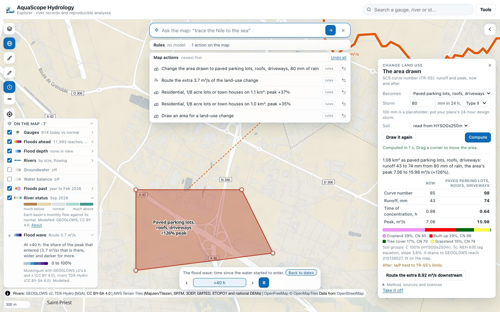

The same function from a terminal and for an agent:

```bash
aquascope landuse --polygon '[[4.955,45.70],[4.97,45.70],[4.97,45.708],[4.955,45.708]]' --use residential_1_8 --rain 100
aquascope landuse --uses
aquascope landuse --check
```

The MCP tool `change_landuse` takes the polygon, the use, `rain_mm`, `distribution`, `soil_group` and
`impervious_pct`, and returns the same numbers, the sources and the licences.

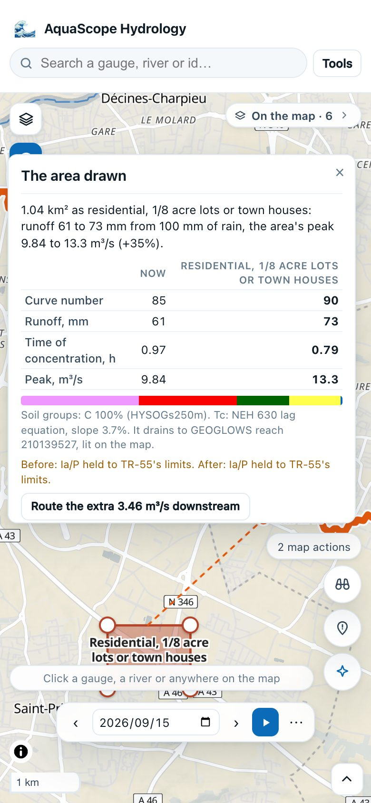

### References

- USDA Soil Conservation Service (1986). *Urban Hydrology for Small Watersheds*, Technical Release 55, 2nd edition
  (210-VI-TR-55).
- USDA NRCS (2025). *National Engineering Handbook*, part 630 Hydrology, subpart F, Time of Concentration (amended
  June 2025).
- Ross, C.W., Prihodko, L., Anchang, J.Y., Kumar, S.S., Ji, W. and Hanan, N.P. (2018). Global Hydrologic Soil Groups
  (HYSOGs250m) for Curve Number-Based Runoff Modeling. ORNL DAAC. doi:10.3334/ORNLDAAC/1566.
- Zanaga, D. et al. (2022). ESA WorldCover 10 m 2021 v200. doi:10.5281/zenodo.7254221.
